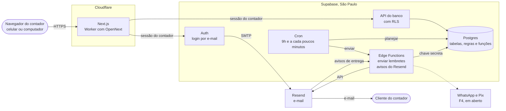
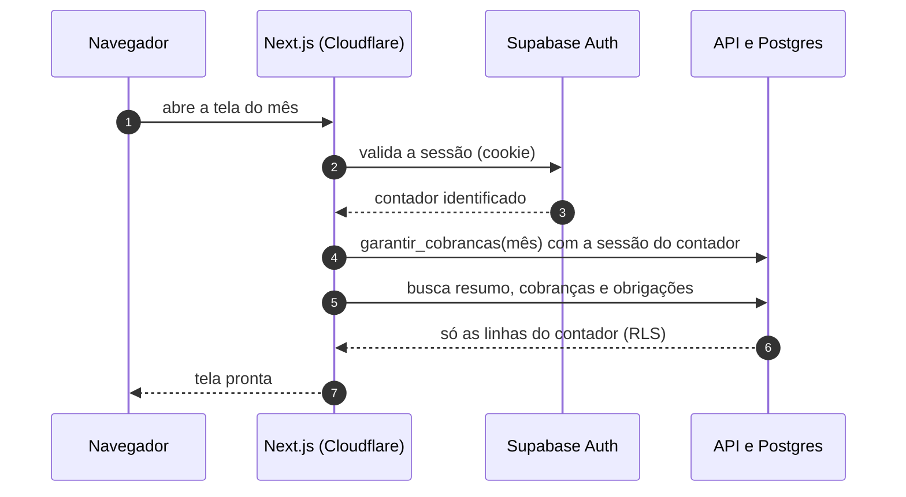
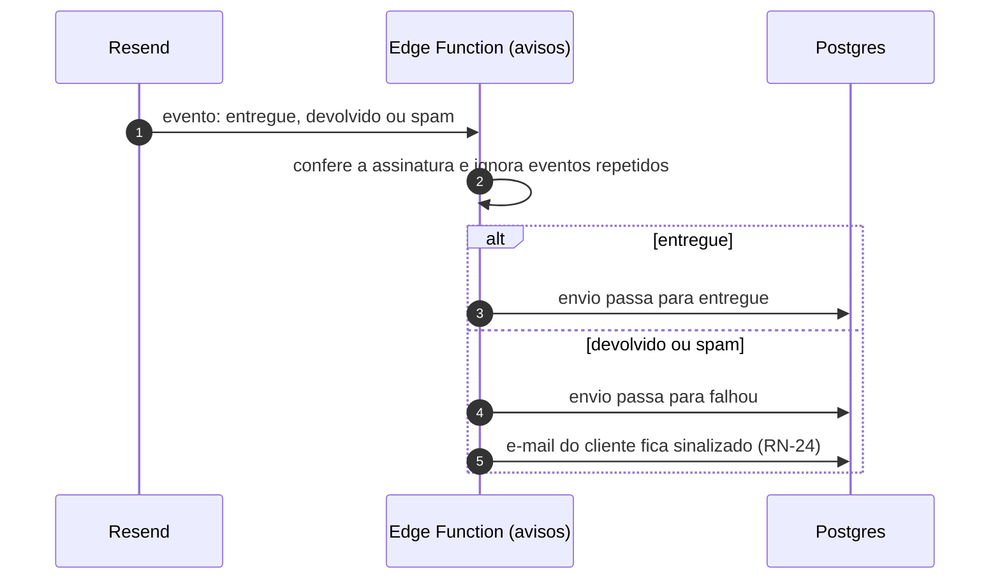
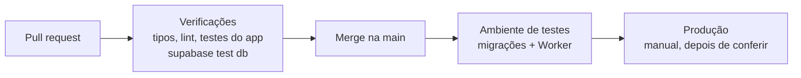

# Arquitetura: Agenda Contábil

**Documentação técnica**

| | |
|---|---|
| **Produto** | Agenda Contábil (nome de trabalho) |
| **Repositório** | `neximob` |
| **Versão** | 1.0 |
| **Data** | 11/11/2026 |
| **Base** | [ADR-0001 a ADR-0007](./adr/README.md) e [SRS](./SRS.md) 1.5 |
| **Documentos relacionados** | [PRD](./PRD.md) · [SRS](./SRS.md) · [Mapa de fluxo](./Mapa%20de%20fluxo.md) |

Este documento junta as decisões de arquitetura numa visão só: o que existe, onde roda, quem acessa o quê e como o sistema é testado e publicado. O motivo de cada escolha está na ADR indicada. Itens marcados como **(proposto)** ainda não foram decididos.

---

## 1. Resumo

| Parte | Tecnologia | ADR |
|---|---|---|
| Interface e rotas de servidor | Next.js em TypeScript, na **Cloudflare Workers** (adaptador OpenNext) | 0001, 0006 |
| Banco de dados | **Postgres do Supabase**, região de São Paulo | 0001, 0006 |
| Login | **Supabase Auth**, por e-mail | 0001 |
| Isolamento entre contadores | **RLS** em todas as tabelas, chaves compostas e permissões por coluna | 0004 |
| Rotina diária | **Supabase Cron** + função no banco + Edge Function | 0005 |
| E-mail | **Resend**: SMTP para o login, API para os lembretes | 0007 |
| WhatsApp e Pix | Em aberto, antes da F4 | 0002, 0003 |

**Princípios**

1. **As regras ficam no banco.** Isolamento, restrições (dia de vencimento de 1 a 28, uma cobrança por cliente e mês), situação da cobrança e geração das cobranças estão no Postgres. A tela, a rotina diária e os testes usam a mesma regra.
2. **A chave secreta do Supabase não sai do Supabase.** Ela só é usada na rotina diária e nos avisos dos provedores, dentro das Edge Functions.
3. **Nada é enviado duas vezes.** O banco recusa envios repetidos, e o Resend recebe uma chave de idempotência por mensagem.
4. **Só os dados necessários.** Sem CPF nem CNPJ no app (ADR-0003); logs sem dados pessoais.
5. **Dados no Brasil.** O banco fica em São Paulo; a Cloudflare só processa as requisições.

---

## 2. Componentes



| Componente | Onde roda | Responsabilidade | ADR |
|---|---|---|---|
| **Next.js** | Cloudflare Workers | Telas (resumo do mês, abas, cadastro), ações do contador. Sempre com a sessão do contador: a RLS vale em toda consulta | 0001, 0006 |
| **Supabase Auth** | Supabase | Cadastro, confirmação de e-mail, login e recuperação de acesso. E-mails pelo SMTP do Resend | 0001, 0007 |
| **Postgres** | Supabase | Dados, RLS, restrições, funções (`garantir_cobrancas`, `status_cobranca`) e gatilhos (conta nova, RN-14, RN-24) | 0004 |
| **Supabase Cron** | Supabase | 9h de Brasília: planejar o dia. A cada poucos minutos: chamar o envio. 9h30: conferir se a rotina rodou | 0005 |
| **Edge Function de envio** | Supabase | Pegar envios pendentes em lotes, conferir se a cobrança continua em aberto e chamar o Resend | 0005, 0007 |
| **Edge Function de avisos do e-mail** **(proposto)** | Supabase | Receber os avisos do Resend (entregue, devolvido, spam), conferir a assinatura e atualizar o envio e a situação do e-mail | 0007 |
| **Resend** | Externo | Entregar os e-mails de login e os lembretes | 0007 |

---

## 3. Fluxos principais

### 3.1 O contador usa a tela



- **(proposto)** A sessão fica em cookies, com a biblioteca `@supabase/ssr`, e o middleware do Next.js renova a sessão a cada requisição.
- A chave usada pelo Next.js é a pública (`publishable`/`anon`). Sozinha, ela não dá acesso a nenhum dado: quem decide é a RLS, a partir da sessão.

### 3.2 Rotina diária

Detalhada na [ADR-0005](./adr/0005-rotina-diaria-supabase-cron.md) e no [Mapa de fluxo](./Mapa%20de%20fluxo.md), seção 8. Resumo: às 9h, uma função no banco cria as cobranças que faltam e grava os lembretes do dia como envios `pendente`; a cada poucos minutos, a Edge Function de envio processa a fila em lotes.

### 3.3 Aviso do Resend (proposto)



---

## 4. Dados e acesso

### 4.1 Esquema físico

O esquema está em [`supabase/migrations/`](../supabase/migrations), aplicado em ordem pela CLI do Supabase:

| Migração | Conteúdo |
|---|---|
| `20261111120000_esquema_inicial.sql` | Tipos e tabelas do modelo do SRS (seção 5) |
| `20261111120100_acesso_rls.sql` | RLS e permissões por tabela e por coluna |
| `20261111120200_funcoes_e_gatilhos.sql` | Regras de negócio no banco: situação da cobrança, cobranças do mês, conta nova, RN-14 e RN-24 |
| `20261111120300_calendario_padrao_2026.sql` | Calendário fiscal padrão de 2026 (datas de exemplo, a conferir) |

**Decisões de desenho**

| Decisão | Por quê |
|---|---|
| `contador_id` em todas as tabelas de dados, com valor padrão `auth.uid()` | Política de acesso igual e simples em todas as tabelas (ADR-0004) |
| Chaves estrangeiras compostas (`id`, `contador_id`) | O banco recusa uma cobrança, um envio ou uma marcação que aponte para o dado de outro contador |
| Chaves únicas começando por `contador_id` | Sem isso, tentar gravar com os ids de outro contador dava "chave duplicada" e revelava que o dado existe. Assim, o erro é sempre "não encontrado". Os testes encontraram e cobrem esse caso |
| `vencimento` guardado na cobrança | Mudar o dia de vencimento do cliente não altera cobranças antigas nem pagas |
| `garantir_cobrancas(mês)` com a permissão de quem chama | A tela cria as cobranças do mês do contador logado; a rotina diária, com a chave secreta, cria as de todos. Nunca duplica |
| `status_cobranca(vencimento, pagamento, hoje)` recebe "hoje" | A RN-02 pode ser testada com qualquer data. A view `cobrancas_situacao` usa o dia de hoje em Brasília |
| View `cobrancas_situacao` com `security_invoker` | A view respeita a RLS de quem consulta |
| Gatilho na criação do usuário | Conta nova já nasce com perfil, régua padrão (RN-08) e calendário padrão (Q-08) |
| Gatilho na mudança de honorário ou de dia de vencimento | Aplica a RN-14 só nas cobranças em aberto do mês corrente em diante |

**Ainda fora do esquema:** a tabela `rotina_execucoes` e a função de planejamento da rotina (F3, ADR-0005), o texto de pendência (depende da confirmação da Q-02) e os campos do Pix e do WhatsApp (F4).

### 4.2 Quem pode o quê

O contador acessa o banco com o papel `authenticated`. A RLS limita as linhas às do próprio contador; as permissões abaixo limitam as operações e as colunas. O que está em "só o sistema" é escrito pela rotina diária ou pelos avisos dos provedores, com a chave secreta.

| Tabela | O contador lê | O contador grava | Só o sistema |
|---|---|---|---|
| `contadores` | O próprio perfil | Nome, chave Pix, aceite dos termos | Plano; e-mail (vem do login) |
| `clientes` | Os próprios | Cria, edita e exclui | Situação do e-mail; id do pagador no provedor de Pix |
| `cobrancas` | As próprias | Cria (pelo `garantir_cobrancas`), dá baixa, ajusta o extra | Id da cobrança no provedor de Pix. Não há exclusão avulsa: as cobranças só saem junto com o cliente |
| `regua` | A própria | Liga, desliga e edita o texto | Cria os 4 passos na conta nova |
| `obrigacoes_padrao` | Todas | Nada | Publicação anual, por migração |
| `obrigacoes` | As próprias | Tudo (RF-23) | Cópia do calendário padrão na conta nova |
| `obrigacoes_feitas` | As próprias | Marca e desmarca | — |
| `envios` | Os próprios | Só envios manuais (botão Cobrar) | Envios automáticos e mudanças de status |
| `envio_cobrancas` | As próprias | Liga um envio manual às cobranças | Ligações dos envios automáticos |

Visitante sem login (`anon`) não acessa nenhuma tabela, view ou função.

### 4.3 Testes do banco

Os testes ficam em [`supabase/tests/database/`](../supabase/tests/database) e usam pgTAP, o framework de testes do Postgres que a CLI do Supabase roda.

| Arquivo | Testes | O que cobre |
|---|---|---|
| `01_isolamento_rls.test.sql` | 37 | Dois contadores: B não lê, não altera, não apaga e não cria dados de A em nenhuma tabela; não descobre a existência de dados de A; campos do sistema protegidos; visitante sem login bloqueado; toda tabela com RLS |
| `02_regras_de_negocio.test.sql` | 36 | Conta nova (RN-08, RF-42), cadastro (RN-07), cobranças do mês (RF-02, RN-21), RN-14, extra e baixa (RF-12, RF-13, RN-01), situação (RN-02), envios (RN-13), e-mail corrigido (RN-24), exclusão em cascata (Q-15) |

**Como rodar**

```bash
supabase start      # sobe o Supabase local (precisa de Docker)
supabase test db    # aplica as migrações e roda os testes
```

---

## 5. Segurança e chaves

| Chave ou segredo | Onde fica | Quem usa |
|---|---|---|
| URL do Supabase e chave pública (`publishable`/`anon`) | Variáveis do Worker na Cloudflare; também chega ao navegador | Next.js e navegador. Não dá acesso a dados sem uma sessão válida |
| Chave secreta do Supabase (`service_role`) | Só no Supabase, nas Edge Functions | Rotina diária e avisos dos provedores (ADR-0004) |
| Chave do Resend para SMTP | Configuração de Auth do Supabase | Supabase Auth (ADR-0007) |
| Chave do Resend para a API | Segredos das Edge Functions | Etapa de envio da rotina (ADR-0007) |
| Segredo de assinatura dos avisos do Resend | Segredos das Edge Functions | Edge Function de avisos |
| Segredo para o Cron chamar a Edge Function | Vault do Supabase | Supabase Cron (ADR-0005) |
| Chaves de WhatsApp e Pix | Segredos das Edge Functions **(proposto)** | F4 |

**Regras**
- Nenhuma chave no código nem no repositório. Arquivos `.env` locais ficam fora do Git.
- A chave secreta nunca vai para a Cloudflare nem para variáveis `NEXT_PUBLIC_*`.
- Comunicação só por HTTPS (RNF-07).
- Logs com ids e contagens, nunca com textos de mensagens, CPF ou CNPJ (ADR-0003, ADR-0005).
- **LGPD:** os dados ficam em São Paulo; CPF e CNPJ nunca são gravados; ao excluir a conta, o Postgres apaga em cascata todos os dados do contador (usuário → perfil → clientes → cobranças, envios e obrigações).

---

## 6. Ambientes (proposto)

| Ambiente | Next.js | Supabase | E-mail | Dados |
|---|---|---|---|---|
| **Local** | `next dev` na máquina de quem desenvolve | `supabase start` (Docker) | Servidor de e-mail de teste do Supabase local: nada sai de verdade | Fictícios |
| **Testes** | Worker separado na Cloudflare | Projeto Supabase separado, em São Paulo | Resend, com domínio de testes | Fictícios |
| **Produção** | Worker de produção | Projeto Supabase de produção, plano pago | Resend, domínio autenticado (RNF-14) | Reais |

Dados reais nunca saem da produção, nem para testes.

---

## 7. Repositório

```text
neximob/
├── docs/                    PRD, SRS, Mapa de fluxo, Arquitetura e ADRs
└── supabase/
    ├── config.toml          configuração do Supabase local (CLI)
    ├── migrations/          esquema do banco, versionado
    ├── tests/database/      testes pgTAP
    └── functions/           Edge Functions (a partir da F3)
```

**(proposto)** O app Next.js entra na raiz do repositório na F2, com a configuração do OpenNext e do Wrangler (CLI da Cloudflare) ao lado.

---

## 8. Publicação e integração contínua (proposto)



- Em cada pull request: verificação de tipos, lint, testes do app e `supabase test db`.
- Depois do merge: as migrações são aplicadas no projeto de testes (`supabase db push`) e o Worker de testes é publicado.
- Produção: publicação manual, primeiro as migrações e depois o Worker.
- Os tipos TypeScript do banco são gerados pela CLI (`supabase gen types`) a cada migração (ADR-0006).

---

## 9. Observabilidade

| O quê | Onde |
|---|---|
| O que foi enviado, para quem e com que resultado | Tabela `envios` (também visível ao contador, RF-35) |
| Se a rotina diária rodou | Tabela `rotina_execucoes` e alerta por e-mail às 9h30 (ADR-0005) |
| Erros e desempenho do Next.js | Logs dos Workers na Cloudflare |
| Erros do banco, do Auth e das Edge Functions | Logs do Supabase |

Nenhum log registra dados pessoais dos clientes do contador.

---

## 10. Custos e planos

| Serviço | Desenvolvimento e validação | Produção |
|---|---|---|
| Cloudflare Workers | Gratuito | Pago: o gratuito limita a 10 ms de CPU por requisição (ADR-0006) |
| Supabase | Gratuito | Pago: o gratuito pausa projetos parados e não atende ao backup diário da RNF-12 |
| Resend | Gratuito | Pago, conforme o volume: até 4 lembretes por cliente por mês, mais os e-mails de login (ADR-0007) |

Os preços mudam. Conferir na hora de contratar.

---

## 11. Pendências técnicas

| Item | Situação | Quando |
|---|---|---|
| Método de login | **(proposto)** E-mail e senha, com confirmação do e-mail e recuperação por e-mail; link mágico pode vir depois | Antes de implementar o login (F2) |
| Nome final e domínio | Define o nome no código e o domínio dos e-mails | Antes da F2 (nome) e da F3 (domínio) |
| Textos padrão da régua | O esquema usa textos iniciais. Substituir pelos do protótipo, se forem diferentes | F2 |
| Datas do calendário padrão de 2026 | Datas de exemplo; conferir com um contador | Antes do uso com dados reais |
| Mecanismo das pendências (Q-02) | Aguarda confirmação; o texto de pendência ainda não está no esquema | Antes da F3 |
| Local dos avisos dos provedores | **(proposto)** Edge Functions do Supabase | F3 (e-mail) e F4 |
| WhatsApp (Q-16) e Pix (Q-17, Q-18) | Em aberto | Antes da F4 |
| Atualização anual do calendário nas contas | **(proposto)** Automática para obrigações não personalizadas (Q-08) | F5 |

---

## 12. Mapa das ADRs

| ADR | Assunto | Seções deste documento |
|---|---|---|
| [0001](./adr/0001-stack-nextjs-supabase.md) | Next.js + Supabase | 1, 2 |
| [0002](./adr/0002-whatsapp-modelos-fixos.md) | WhatsApp com modelos fixos | 1, 11 |
| [0003](./adr/0003-cpf-cnpj-so-no-provedor.md) | CPF e CNPJ só no provedor | 1, 5 |
| [0004](./adr/0004-isolamento-por-contador-rls.md) | Isolamento com RLS | 4 |
| [0005](./adr/0005-rotina-diaria-supabase-cron.md) | Rotina diária | 2, 3.2, 9 |
| [0006](./adr/0006-hospedagem-cloudflare-supabase-sao-paulo.md) | Cloudflare, São Paulo, TypeScript | 1, 2, 6, 10 |
| [0007](./adr/0007-email-resend.md) | E-mail com o Resend | 2, 3.3, 5, 10 |

---

## 13. Histórico do documento

| Versão | Data | Alteração |
|---|---|---|
| 1.0 | 11/11/2026 | Primeira versão: componentes, fluxos, esquema físico e testes do banco, chaves, ambientes, publicação, custos e pendências |
