# Mapa de fluxo: Agenda Contábil

**Telas e caminhos do usuário**

| | |
|---|---|
| **Produto** | Agenda Contábil (nome de trabalho) |
| **Repositório** | `neximob` |
| **Versão** | 1.0, rascunho para validação |
| **Data** | 07/11/2026 |
| **Fontes** | *Agenda Contábil: Documentação do Produto* (seção 3, User Flow) e *Agenda Contábil: Briefing para desenvolvimento*, ambos de 03/11/2026 |
| **Documentos relacionados** | [PRD](./PRD.md) · [SRS](./SRS.md) |

**Legenda**

| Marcação | Significado |
|---|---|
| **Atual** | Já existe no protótipo |
| **Versão final** | Previsto nas fontes, ainda a construir |
| **(proposto)** | Acrescentado por este documento; precisa ser validado |

Os códigos `RF`, `RN`, `RNF` e `Q` se referem ao [SRS](./SRS.md).

---

## 1. Mapa de telas

O app é **uma tela só**: o resumo do mês no topo e três abas. As ações secundárias abrem janelas sobre essa tela.

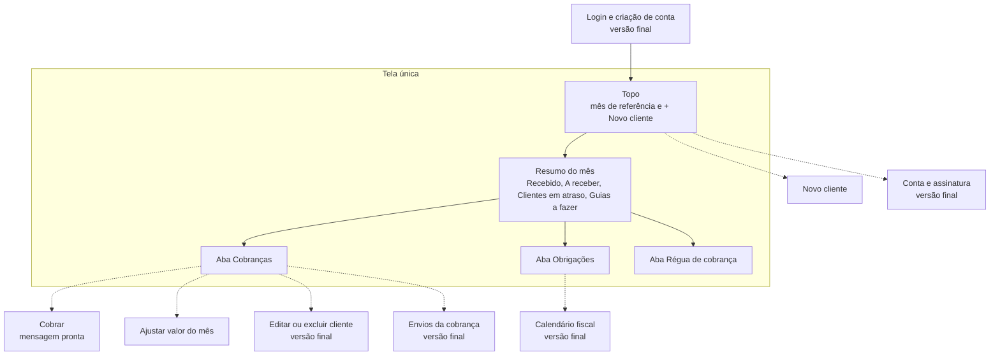

| Parte da tela | O que tem | Situação | Requisitos |
|---|---|---|---|
| Topo | Mês de referência e botão **+ Novo cliente** | Atual. Na versão final, o mês de referência permite ver meses anteriores | RF-01, RF-18 |
| Resumo do mês | Recebido (com barra de %), a receber, clientes em atraso, guias a fazer | Atual | RF-03 |
| Aba Cobranças | Lista de clientes, filtros, cobrar, marcar pago, ajustar valor | Atual, com envio simulado | RF-10 a RF-18 |
| Aba Obrigações | Checklist do mês e próximos prazos do ano | Atual, com datas de exemplo | RF-20 a RF-24 |
| Aba Régua de cobrança | Chave Pix, 4 lembretes editáveis e prévia | Atual, sem disparo real | RF-30 a RF-33 |
| Login e conta | Criar conta, entrar, perfil, termos, assinatura | Versão final | RF-40 a RF-45, RF-50 |
| Calendário fiscal | Cadastrar e corrigir obrigações e datas | Versão final | RF-23 |

No celular, as listas viram cartões (RNF-01). A tela tem tema claro e escuro (RNF-02).

---

## 2. Primeiro acesso (versão final)

A ordem das etapas é **(proposto)**. As fontes pedem que, na primeira vez, o contador cadastre os clientes e ajuste a régua e a chave Pix.

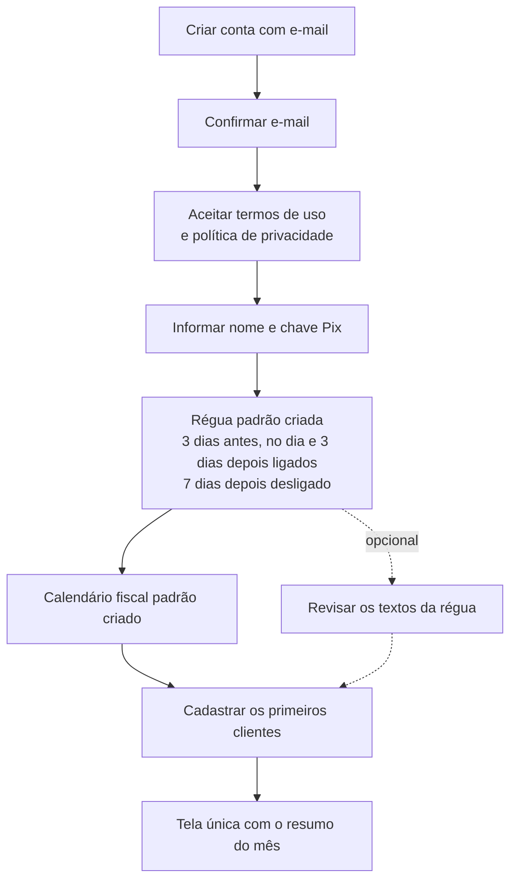

**Requisitos:** RF-40, RF-42, RF-43, RF-30, RF-20, RF-01.

---

## 3. Rotina mensal do contador

Este é o uso esperado ao longo do mês, segundo a Documentação do Produto:

1. Cadastrar os clientes uma vez, com honorário e dia de vencimento.
2. Ajustar a régua e a chave Pix na primeira vez.
3. Ao longo do mês, abrir **Cobranças** e marcar quem pagou.
4. Lançar os serviços extras do mês em **Ajustar valor do mês**.
5. Em **Obrigações**, marcar cada guia feita, por cliente, até o dia 20.

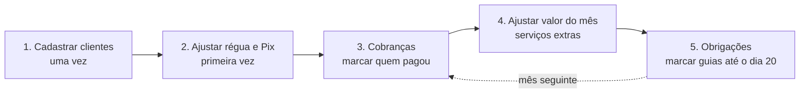

Na versão final, o passo 3 fica menor: os lembretes saem sozinhos (RF-34) e o Pix dá a baixa (RF-17). O contador só marca à mão quem pagou por outro meio.

---

## 4. Ciclo mensal de cobrança

A régua cobra até o cliente pagar e recomeça no mês seguinte. Depois de cada lembrete, o app confere de novo se o cliente pagou. No protótipo, o envio e a baixa são manuais; na versão final, os lembretes saem sozinhos e o Pix dá a baixa.

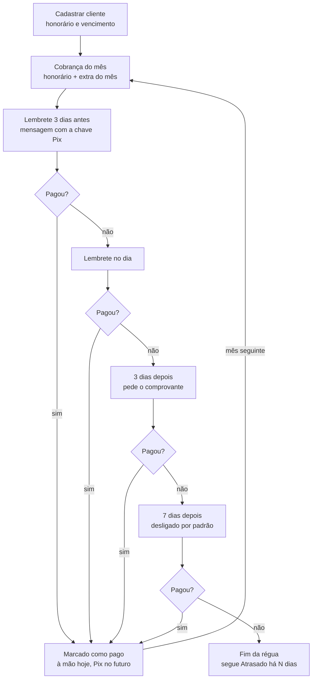

| Passo | Quando | Padrão | Mensagem |
|---|---|---|---|
| 3 dias antes | Vencimento − 3 dias | Ligado | Lembrete com a chave Pix |
| No dia | Dia do vencimento | Ligado | Lembrete do vencimento |
| 3 dias depois | Vencimento + 3 dias | Ligado | Cobrança que pede o comprovante |
| 7 dias depois | Vencimento + 7 dias | Desligado | Última cobrança |

**Regras:** só dispara para quem não pagou (RN-09); passo desligado é pulado; cada passo sai no máximo uma vez por cobrança e canal (RN-13, proposto). Depois do último passo ligado, a cobrança continua atrasada até ser paga. Cobranças antigas não pagas: ver Q-02.

---

## 5. Estados de uma cobrança

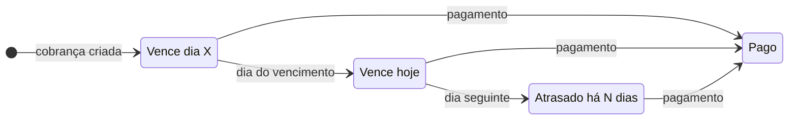

- **Pagamento** é a baixa manual (RF-12) ou a confirmação do Pix (RF-17).
- **Desfazer** apaga o pagamento, e a cobrança volta ao estado que a data indica: "Vence dia X", "Vence hoje" ou "Atrasado há N dias".
- O status nunca é digitado: ele é calculado pela RN-02 a partir da data de vencimento e da existência de pagamento. Uma cobrança criada depois do vencimento já nasce como "Vence hoje" ou "Atrasado" (ver Q-01).

---

## 6. Cadastrar, editar e excluir cliente

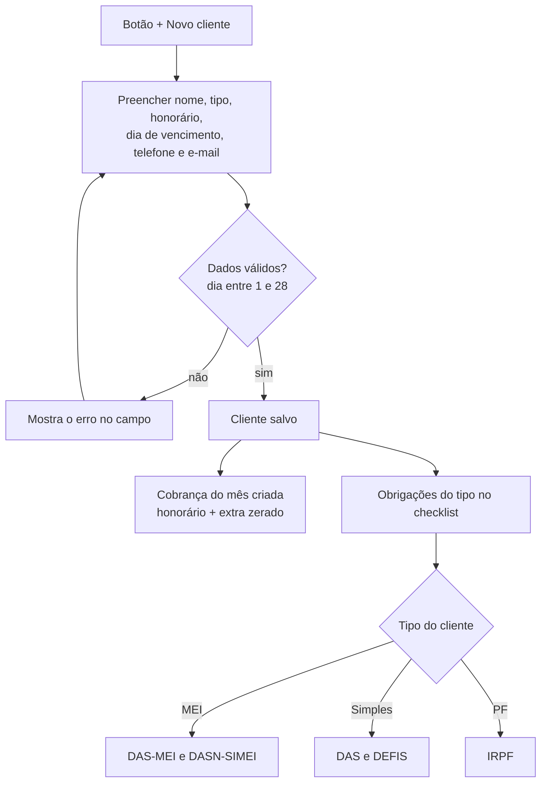

**Editar e excluir (versão final)**

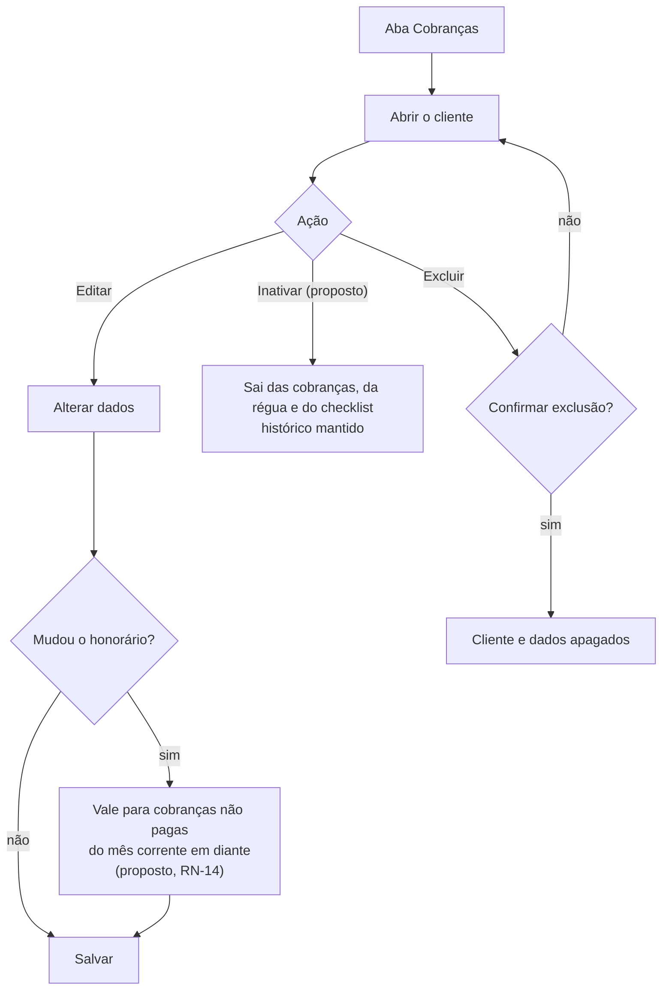

**Requisitos:** RF-01, RF-02, RF-04, RF-05, RF-06, RN-07, RN-10, RN-14, RN-16.

---

## 7. Cobranças: acompanhar, cobrar e dar baixa

### 7.1 Visão geral da aba

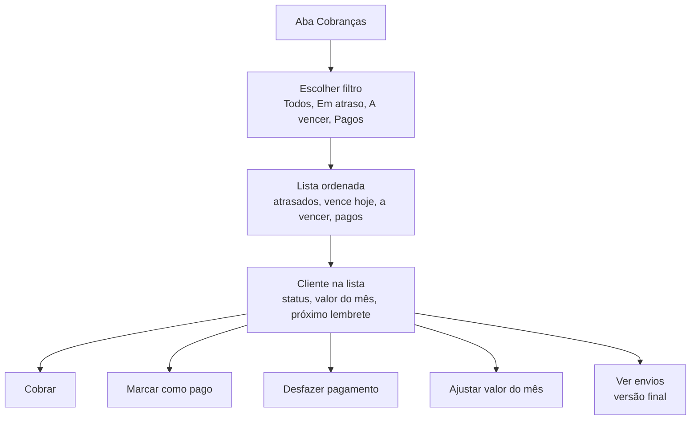

**Requisitos:** RF-10, RF-11, RF-15.

### 7.2 Cobrar à mão (atual)

O botão **Cobrar** monta a mensagem do passo certo para o status do cliente (RN-03). No protótipo, o envio é simulado: o contador copia a mensagem e cola no WhatsApp ou no e-mail.

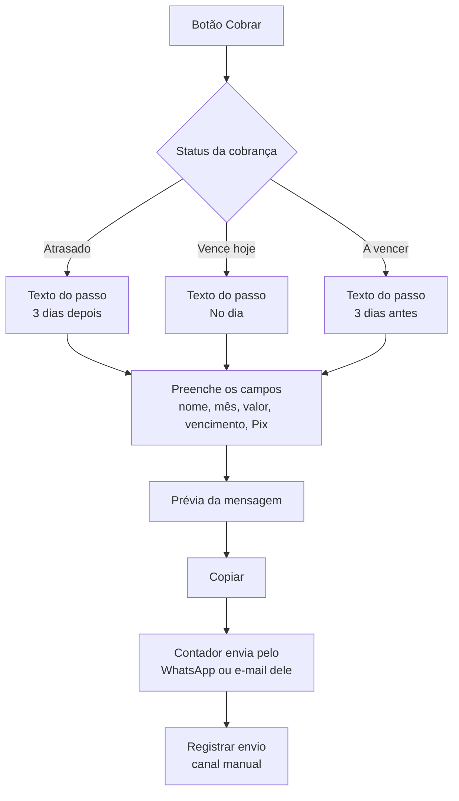

**Requisitos:** RF-14, RF-32, RN-03, RN-05, RN-11. Passo desligado na régua: ver Q-03.

### 7.3 Marcar como pago e desfazer

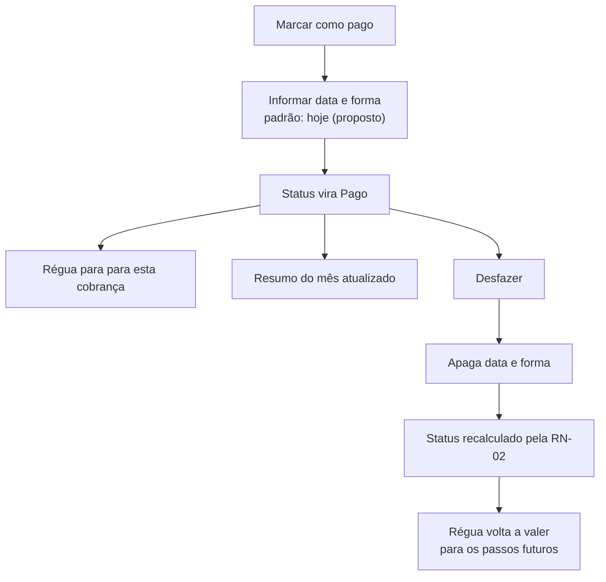

**Requisitos:** RF-12, RF-03, RN-02, RN-09.

### 7.4 Ajustar o valor do mês

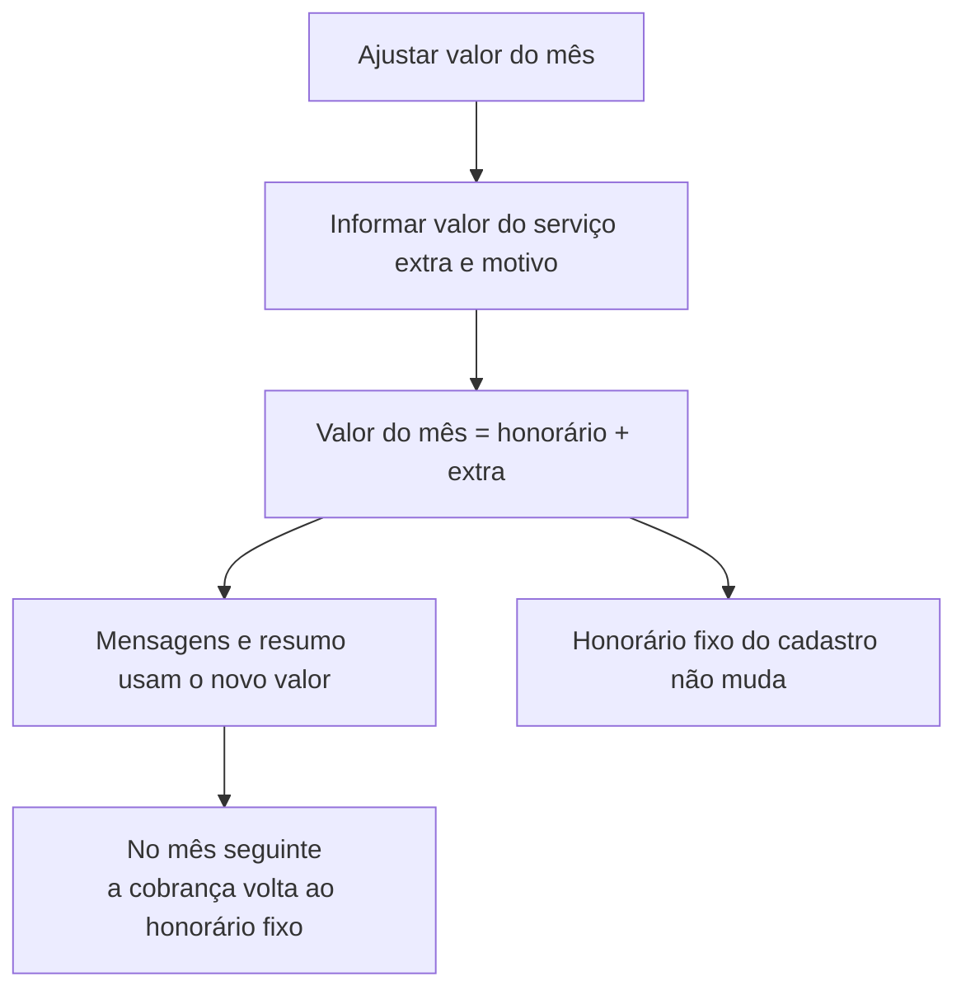

**Requisitos:** RF-13, RN-01, RN-15.

---

## 8. Rotina diária automática (versão final)

Uma vez por dia, o sistema confere os vencimentos e dispara o passo certo da régua, sem ação do contador.

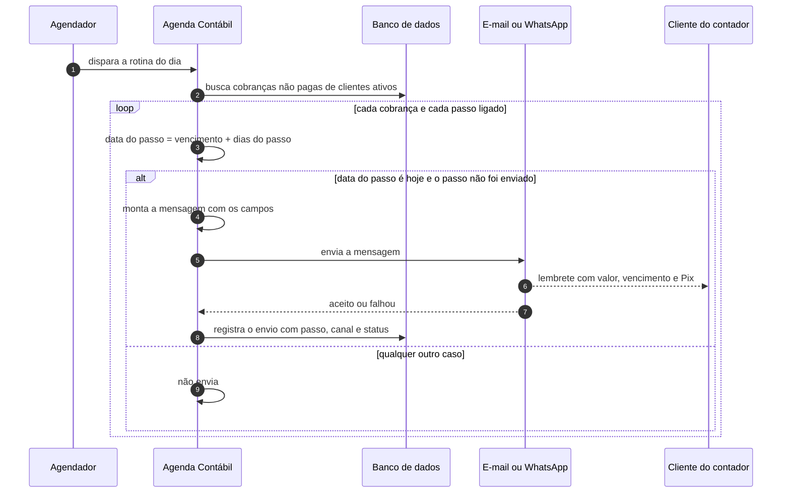

| Situação | Comportamento |
|---|---|
| Cliente pagou antes da rotina rodar | Não envia (RN-09) |
| Passo desligado | Não envia |
| Rotina roda duas vezes no mesmo dia | Não repete o envio (RN-13, proposto) |
| Cliente sem e-mail e sem telefone | Não envia; a cobrança mostra "sem contato" (RN-17, proposto) |
| Provedor recusa a mensagem | Registra o envio como "falhou"; o contador vê a falha na cobrança (RF-35) |
| Rotina deixou de rodar num dia | Ver Q-09 |

**Requisitos:** RF-16, RF-34, RF-35, RNF-09.

---

## 9. Pagamento por Pix com baixa automática (versão final)

O provedor de Pix ainda não foi escolhido (Asaas ou similar). O fluxo abaixo é **(proposto)** e independe do provedor.

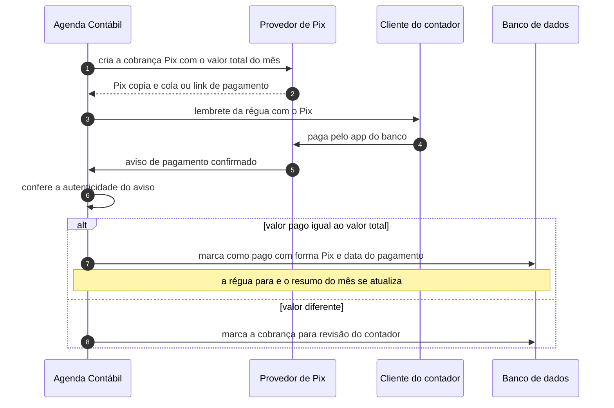

| Situação | Comportamento **(proposto)** |
|---|---|
| Aviso de pagamento repetido | Não gera baixa duplicada |
| Contador dá baixa manual com o Pix em aberto | O sistema cancela a cobrança no provedor |
| Contador muda o valor do mês com o Pix em aberto | O sistema cancela o Pix antigo e gera outro com o novo valor |
| Provedor exige CPF ou CNPJ do pagador | Ver Q-12 |

**Requisitos:** RF-17, RNF-07, RN-09. Página do cliente para pagar: RF-60, em aberto.

---

## 10. Obrigações: checklist do mês

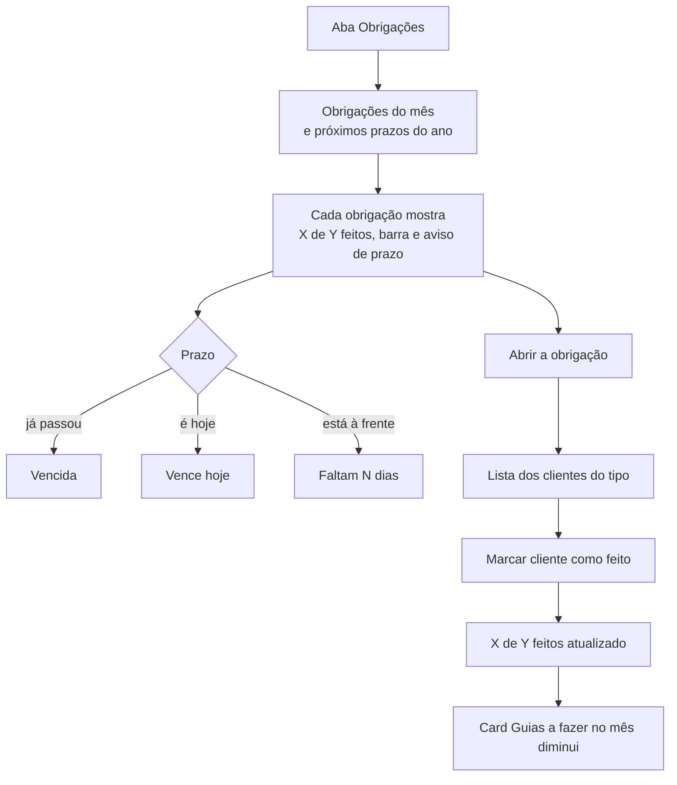

| Obrigação | Tipo de cliente | Periodicidade | Período da marcação |
|---|---|---|---|
| DAS-MEI | MEI | Mensal (dia 20) | Mês |
| DAS do Simples | Simples | Mensal (dia 20) | Mês |
| DEFIS | Simples | Anual | Ano |
| DASN-SIMEI | MEI | Anual | Ano |
| IRPF | PF | Anual | Ano |

As datas do protótipo são de exemplo e precisam ser conferidas por um contador. Competência da guia: ver Q-07. Prazo em fim de semana ou feriado: ver Q-06.

**Requisitos:** RF-20, RF-21, RF-22, RF-24, RN-06, RN-10.

---

## 11. Configurar a régua de cobrança

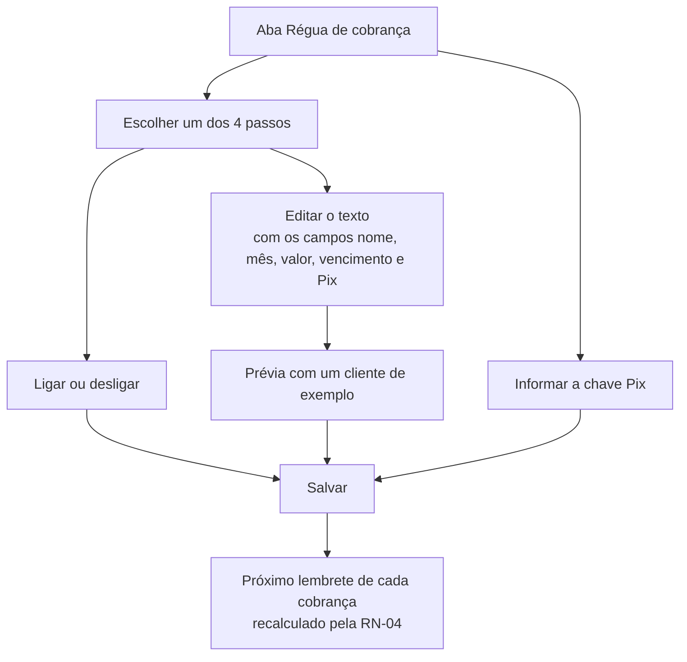

No texto, os campos são escritos entre chaves: `{nome}`, `{mes}`, `{valor}`, `{venc}` e `{pix}`. No WhatsApp, só é possível enviar modelos aprovados pela Meta: ver Q-04.

**Requisitos:** RF-30, RF-31, RF-32, RF-33, RN-04, RN-05, RN-08.

---

## 12. Calendário fiscal editável (versão final)

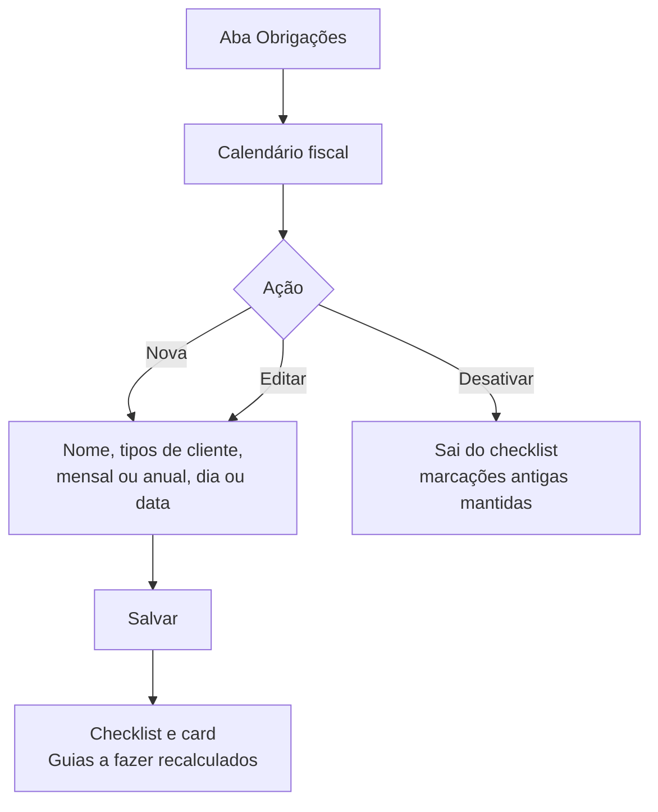

As regras fiscais mudam: as datas devem ser fáceis de atualizar e conferidas por um contador. Quem mantém o calendário padrão: ver Q-08.

**Requisitos:** RF-23, RNF-11.

---

## 13. Histórico dos meses anteriores (versão final)

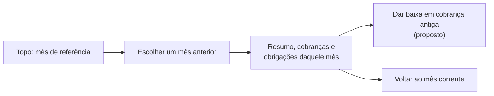

**Requisitos:** RF-18. Cobranças antigas não pagas no mês corrente: ver Q-02.

---

## 14. Assinatura do app (versão final)

Preço, período de teste e regra de inadimplência ainda estão em aberto. O fluxo abaixo é **(proposto)**.

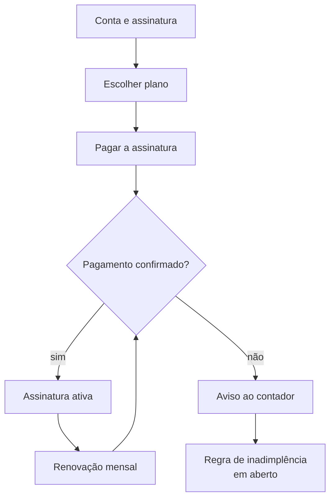

**Requisitos:** RF-50.

---

## 15. Exceções e mensagens de erro

| Situação | Comportamento esperado | Referência |
|---|---|---|
| Dia de vencimento fora de 1 a 28 | Não salva e mostra a faixa permitida | RN-07 |
| Campo obrigatório vazio no cadastro | Não salva e indica o campo | RF-01 |
| Cliente sem e-mail e sem telefone | Sem envio automático; aviso "sem contato"; a mensagem para copiar continua disponível | RN-17 (proposto) |
| Envio recusado pelo provedor | Envio registrado como "falhou" e destacado na cobrança | RF-35 |
| Cliente pagou, mas o contador ainda não marcou | O lembrete pode sair. Mitigação: baixa automática por Pix; **(proposto)** texto com "se já pagou, desconsidere" | RF-17, RN-09 |
| Aviso de pagamento Pix repetido | Uma baixa só | RF-17 (proposto) |
| Valor pago diferente do esperado | Cobrança marcada para revisão | Q-13 |
| Contador desfaz um pagamento | Status recalculado; a régua volta para os passos futuros | RF-12 |
| Todos os passos da régua desligados | "Sem próximos lembretes" na cobrança | RF-15 (proposto) |
| Campo desconhecido no texto da régua | Aviso antes de salvar | RF-32 (proposto) |
| Rotina diária não rodou | Alerta; recuperação segundo Q-09 | RNF-09 |
| Sessão expirada | Volta ao login, sem perder o que foi salvo | RF-40 |

---

## 16. Rastreabilidade: fluxos → requisitos

| Fluxo | Seção | Requisitos |
|---|---|---|
| Mapa de telas | 1 | RF-01, RF-03, RF-10 a RF-24, RF-30 a RF-33, RNF-01, RNF-02 |
| Primeiro acesso | 2 | RF-40, RF-42, RF-43, RF-20, RF-30, RF-01 |
| Rotina mensal do contador | 3 | RF-01, RF-12, RF-13, RF-21, RF-31, RF-33 |
| Ciclo mensal de cobrança | 4 | RF-30, RF-34, RN-08, RN-09, RN-13 |
| Estados da cobrança | 5 | RF-10, RF-12, RN-02 |
| Cadastro de cliente | 6 | RF-01, RF-02, RF-04 a RF-06, RN-07, RN-10, RN-14 |
| Cobranças | 7 | RF-10 a RF-15, RN-01, RN-03 |
| Rotina diária | 8 | RF-16, RF-34, RF-35, RNF-09 |
| Pix com baixa automática | 9 | RF-17, RNF-07 |
| Obrigações | 10 | RF-20 a RF-22, RF-24, RN-06, RN-10 |
| Régua de cobrança | 11 | RF-30 a RF-33, RN-04, RN-05 |
| Calendário fiscal | 12 | RF-23, RNF-11 |
| Histórico | 13 | RF-18 |
| Assinatura | 14 | RF-50 |

---

## 17. Histórico do documento

| Versão | Data | Alteração |
|---|---|---|
| 1.0 | 07/11/2026 | Primeira versão, a partir do User Flow da Documentação do Produto e do Briefing de 03/11/2026 |
