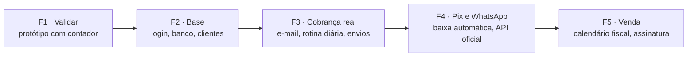

# PRD: Neximob

**Documento de Requisitos do Produto**

| | |
|---|---|
| **Produto** | Neximob |
| **Repositório** | `neximob` |
| **Versão** | 1.7, rascunho para validação |
| **Data** | 11/11/2026 |
| **Fontes** | *Agenda Contábil: Documentação do Produto* e *Agenda Contábil: Briefing para desenvolvimento*, ambos de 03/11/2026, de William Henrique Moreira Dias |
| **Documentos relacionados** | [SRS](./SRS.md) · [Mapa de fluxo](./Mapa%20de%20fluxo.md) · [Arquitetura](./Arquitetura.md) · [Decisões de arquitetura (ADR)](./adr/README.md) |

> **Como ler este documento.** O conteúdo vem das fontes acima. O que foi acrescentado aqui e não está nas fontes aparece marcado como **(proposto)** e precisa ser validado antes de virar requisito.

---

## 1. Visão geral

O Neximob é um sistema simples para o **contador autônomo ou de escritório pequeno**. O contador cadastra cada cliente uma vez e, a partir daí, o sistema cuida de duas rotinas mensais:

- **Cobrança dos honorários.** Calcula o valor do mês, mostra quem já pagou e envia lembretes antes e depois do vencimento, com a chave Pix.
- **Prazos fiscais.** Monta o checklist das obrigações de cada cliente (DAS-MEI, DAS, DEFIS, DASN-SIMEI e IRPF) e mostra quantos clientes já foram feitos.

Tudo fica numa tela só: o resumo do mês no topo e três abas (Cobranças, Obrigações e Régua de cobrança).

**Situação atual.** Existe um protótipo clicável: uma página HTML com JavaScript puro, sem biblioteca e sem servidor. Os clientes são de exemplo, os dados ficam só no navegador de quem abre e nenhuma mensagem é enviada de verdade. O protótipo serve de referência de telas, textos e regras para a versão final.

---

## 2. Problema

O contador autônomo controla honorários e prazos em planilha, caderno e WhatsApp. O resultado:

| Dor | Efeito no dia a dia |
|---|---|
| Cobra cliente por cliente, à mão | Perde tempo todo mês, e a cobrança só acontece se ele lembrar |
| Controle espalhado entre planilha, caderno e WhatsApp | Não sabe de bate-pronto quem já pagou nem quanto falta receber |
| Prazos como DAS, DEFIS e IR dependem da memória | Corre o risco de esquecer a guia de algum cliente |

---

## 3. Público-alvo

### 3.1 Perfis

| Perfil | Usa o app? | O que precisa |
|---|---|---|
| **Contador autônomo ou de escritório pequeno** (usuário) | Sim | Ver quem pagou, cobrar sem esforço e saber quais guias faltam no mês |
| **Cliente do contador**: MEI, Simples Nacional ou pessoa física | Não | Receber o lembrete do honorário com valor, vencimento e chave Pix |

### 3.2 Características do usuário principal

- Trabalha sozinho ou num escritório pequeno.
- Tem poucos clientes, dos tipos MEI, Simples Nacional e pessoa física.
- Hoje usa planilha, caderno e WhatsApp.
- Usa o celular e o computador.
- Quer algo leve e barato, e não um sistema contábil completo.

### 3.3 Quem não é o público

- Escritórios que precisam de um sistema contábil completo, com muitas funções. Esse espaço é dos sistemas grandes, como Makro, Nibo e Questor.
- Contadores cuja carteira é de outros regimes (Lucro Presumido, Lucro Real). O app só trata MEI, Simples Nacional e pessoa física.

### 3.4 Histórias principais

| # | Como contador, quero... | Para... | Requisitos |
|---|---|---|---|
| H1 | cadastrar o cliente uma vez, com honorário e dia de vencimento | não precisar lançar cobrança e prazos todo mês | RF-01, RF-02 |
| H2 | ver no topo quanto recebi, quanto falta e quem está atrasado | saber a situação do mês em segundos | RF-03, RF-10, RF-11 |
| H3 | que os lembretes saiam sozinhos antes e depois do vencimento | parar de cobrar cliente por cliente | RF-16, RF-30 a RF-35 |
| H4 | que o pagamento por Pix dê baixa sozinho | não precisar conferir extrato e marcar "pago" à mão | RF-17 |
| H5 | lançar um serviço extra só naquele mês | cobrar o extra sem mexer no honorário fixo | RF-13 |
| H6 | marcar, cliente por cliente, cada guia feita | não esquecer nenhum prazo fiscal | RF-20 a RF-22 |
| H7 | cadastrar e corrigir obrigações e datas | acompanhar as mudanças das regras fiscais | RF-23 |
| H8 | acessar do celular e do computador | trabalhar de onde estiver | RNF-01, RNF-03 |

---

## 4. Posicionamento

Leve e barato, o oposto dos sistemas contábeis grandes como Makro, Nibo e Questor. O Neximob não compete em quantidade de funções: é tudo numa tela só, para quem trabalha sozinho.

### Princípios de produto

1. **Uma tela só.** Resumo do mês no topo e três abas. **(proposto)** Função nova só entra se couber nesse desenho.
2. **Cadastrar uma vez.** A cobrança e os prazos do cliente entram sozinhos todo mês.
3. **Automático por padrão.** A régua já vem ligada: 3 dias antes, no dia e 3 dias depois.
4. **Não prometer o que não faz.** O app não calcula impostos e não emite nota fiscal.
5. **Celular primeiro.** No celular, a lista vira cartões.
6. **Regras fiscais são editáveis.** Datas e obrigações mudam, então precisam ser fáceis de atualizar e conferidas por um contador.

---

## 5. Objetivos

| # | Objetivo | Como o produto entrega | Requisitos |
|---|---|---|---|
| O1 | **Cobrança no piloto automático** | Lembretes antes e depois do vencimento, sem o contador lembrar | RF-16, RF-17, RF-30 a RF-35 |
| O2 | **Saber em segundos quanto entrou e quanto falta no mês** | Resumo do mês com recebido (%), a receber, atrasados e guias a fazer | RF-03, RF-10 a RF-12 |
| O3 | **Nenhum prazo fiscal esquecido** | Cada obrigação mostra quantos clientes já foram feitos | RF-20 a RF-24 |
| O4 | **Cadastrar uma vez** | A cobrança e os prazos do cliente entram sozinhos todo mês | RF-01, RF-02 |

---

## 6. Métricas de sucesso

### 6.1 Métricas visíveis no app

| Métrica | Onde aparece no app |
|---|---|
| Percentual recebido no mês | Barra do card "Recebido" |
| Clientes em atraso | Card "Clientes em atraso" |
| Guias pendentes no mês | Card "Guias a fazer no mês" |
| Tempo gasto cobrando | Ainda não medido; perguntar ao contador antes e depois |

Ainda não há metas numéricas. Elas devem sair da validação com contadores (Fase 1).

### 6.2 Métricas de produto (proposto)

| Métrica | Definição | Para que serve |
|---|---|---|
| Ativação | % de contas novas que cadastram clientes e informam a chave Pix na primeira semana | Saber se o primeiro acesso funciona |
| Uso recorrente | % de contadores que abrem o app toda semana | Confirmar o uso frequente que a validação quer medir |
| Pagamento em dia | % das cobranças pagas até o vencimento | Medir o efeito da régua (O1) |
| Atraso médio | Média de dias entre o vencimento e o pagamento | Medir o efeito da régua (O1) |
| Pagamento por passo | % das cobranças pagas depois de cada passo da régua | Ajustar textos e dias da régua |
| Guias no prazo | % das obrigações marcadas como feitas até o prazo | Medir O3 |
| Tempo gasto cobrando | Horas por mês, antes e depois de usar o app (entrevista) | Medir O1 |
| Conversão e cancelamento | % de contas que assinam e % que cancelam por mês | Viabilidade do negócio (Fase 5) |

---

## 7. Escopo

### 7.1 O que o protótipo já tem

| Parte | O que faz | Situação |
|---|---|---|
| Resumo do mês | Recebido, a receber, clientes em atraso e guias a fazer | Pronto |
| Cobranças | Lista de clientes por status, filtros, marcar pago, ajustar o valor do mês (serviço extra) e mensagem pronta | Envio simulado |
| Obrigações | Checklist por obrigação (DAS-MEI, DAS, DEFIS, DASN-SIMEI, IRPF), com feitos e faltantes, mensais e anuais | Datas de exemplo |
| Régua de cobrança | 4 lembretes editáveis, liga e desliga, chave Pix e prévia | Sem disparo real |
| Novo cliente | Nome, tipo, honorário mensal e dia de vencimento | Pronto |

### 7.2 O que falta para virar produto

| # | Item | Fase | Requisitos |
|---|---|---|---|
| 1 | Login e banco de dados, com cada contador na sua conta | F2 | RF-40 a RF-45, RNF-03, RNF-05 |
| 2 | Cadastro completo do cliente: editar, excluir, telefone e e-mail | F2 | RF-04, RF-05, RF-06 |
| 3 | Envio real da cobrança por e-mail e, depois, por WhatsApp | F3 (e-mail), F4 (WhatsApp) | RF-16, RF-35 |
| 4 | Rotina automática diária que dispara a régua | F3 | RF-34 |
| 5 | Cobrança por Pix com baixa automática | F4 | RF-17 |
| 6 | Calendário fiscal editável pelo contador | F5 | RF-23 |
| 7 | Histórico dos meses anteriores | Sem fase nas fontes; **(proposto)** F3 | RF-18 |
| 8 | Assinatura mensal do app | F5 | RF-50 |

### 7.3 Fora do escopo

- Emissão de nota fiscal.
- Integração com a Receita Federal ou com o e-CAC.
- Cálculo de impostos. O app não deve prometer isso.
- Relatórios contábeis.

### 7.4 Em aberto

- Página para o cliente do contador ver e pagar o honorário (RF-60).
- Mais de um usuário na mesma conta de escritório. Na F2, vale uma conta por contador; o tema volta depois da validação (SRS, Q-14).

---

## 8. Funcionalidades

| Módulo | O que faz | Situação | Requisitos |
|---|---|---|---|
| **Resumo do mês** | Topo da tela com quatro cards: Recebido (com barra de %), A receber, Clientes em atraso e Guias a fazer no mês | Pronto | RF-03 |
| **Cobranças** | Lista do mês com status (Pago, Vence dia X, Vence hoje, Atrasado há N dias), filtros, marcar pago e desfazer, ajustar o valor do mês, mensagem pronta e data do próximo lembrete. Na versão final: envio real, Pix com baixa automática e histórico | Envio simulado | RF-10 a RF-18 |
| **Obrigações** | Checklist do mês por obrigação, com "X de Y feitos", barra de progresso, avisos de prazo e próximos prazos do ano. Na versão final: calendário editável | Datas de exemplo | RF-20 a RF-24 |
| **Régua de cobrança** | Quatro lembretes (3 dias antes, no dia e 3 dias depois ligados; 7 dias depois desligado), chave Pix e prévia. Textos editáveis no e-mail; no WhatsApp, modelos fixos aprovados (ADR-0002). Na versão final: disparo diário automático, que inclui as pendências de meses anteriores | Sem disparo real | RF-30 a RF-35 |
| **Clientes** | Cadastro com nome, tipo, honorário e dia de vencimento (1 a 28). Na versão final: telefone, e-mail, edição e exclusão | Parcial | RF-01, RF-02, RF-04 a RF-06 |
| **Conta e assinatura** | Login por e-mail, uma conta por contador, consentimento (LGPD) e assinatura mensal | A fazer | RF-40 a RF-45, RF-50 |

O detalhamento de cada requisito está no [SRS](./SRS.md), e os caminhos do usuário estão no [Mapa de fluxo](./Mapa%20de%20fluxo.md).

---

## 9. Roadmap

| Fase | Objetivo | Entregas | Critério para avançar **(proposto)** |
|---|---|---|---|
| **F1 · Validar** | Confirmar uso e preço antes de programar | Mostrar o protótipo a um contador e ajustar | Um contador confirma que usaria e diz quanto pagaria |
| **F2 · Base** | Dados reais, seguros e acessíveis de qualquer aparelho | Login, banco de dados e cadastro completo do cliente, com as telas do protótipo ligadas ao banco | O contador usa o app com os próprios clientes, no celular e no computador |
| **F3 · Cobrança real** | Lembretes saem sozinhos | Envio por e-mail, rotina diária e registro dos envios | Um ciclo mensal completo sem o contador disparar nada à mão |
| **F4 · Pix e WhatsApp** | Baixa automática e o canal que o cliente mais usa | Pix com baixa automática e WhatsApp pela API oficial | Pagamentos por Pix baixados sem intervenção |
| **F5 · Venda** | Produto vendável | Calendário fiscal editável e assinatura mensal | Primeiros contadores pagando |

A ordem segue as prioridades da Documentação do Produto: validar, login e banco, envio real, rotina diária, Pix, calendário fiscal e, por último, cobrar a mensalidade, depois de provar que o contador usa.

---

## 10. Premissas, restrições e regras invioláveis

### 10.1 Regras que não podem mudar

Estas regras vêm do Briefing (seção 6) e valem para qualquer implementação. A especificação de cada uma está no SRS.

| Regra | SRS |
|---|---|
| Valor do mês = honorário fixo + serviço extra só daquele mês | RN-01 |
| Status: pago; senão, a vencer, vence hoje ou atrasado há N dias, pelo dia de vencimento | RN-02 |
| Régua padrão: 3 dias antes, no dia e 3 dias depois ligados; 7 dias depois desligado | RN-08 |
| A régua só dispara para quem não pagou | RN-09 |
| Campos da mensagem: `{nome}` (primeiro nome), `{mes}`, `{valor}`, `{venc}`, `{pix}` | RN-05, RN-11 |
| Obrigações por tipo: MEI → DAS-MEI e DASN-SIMEI; Simples → DAS e DEFIS; PF → IRPF | RN-10 |
| Dia de vencimento entre 1 e 28 | RN-07 |
| O app não calcula impostos e não deve prometer isso | RN-12 |

### 10.2 Restrições

- **WhatsApp.** Mensagem em massa exige a API oficial e modelos de mensagem aprovados. Disparo automático por número comum pode bloquear o número.
- **LGPD.** O sistema guarda nome, valores e situação fiscal de terceiros. Precisa de login seguro e de consentimento.
- **Regras fiscais mudam.** Datas e obrigações devem ser fáceis de atualizar e conferidas por um contador.
- **Experiência.** Tudo em português, valores em reais, funcionando no celular, mantendo o visual do protótipo.
- **Tecnologia.** Next.js em TypeScript, hospedado na Cloudflare, e Supabase (Postgres e Auth) na região de São Paulo (ADR-0001, ADR-0006).
- **Documentos dos clientes.** O app não guarda CPF nem CNPJ. Quando o provedor de Pix exigir, o dado fica só nele (ADR-0003).

### 10.3 Premissas (proposto)

- O contador tem uma chave Pix para receber os honorários.
- Os clientes têm e-mail ou celular para receber os lembretes.
- Cada contador tem poucos clientes: dezenas, não milhares.
- O contador continua responsável por calcular impostos e conferir prazos fora do app.

---

## 11. Riscos

| Risco | Impacto | Mitigação |
|---|---|---|
| O contador não adota o app e continua cobrando pelo WhatsApp | Produto sem uso | Validar antes de programar (F1); primeiro acesso em poucos minutos; régua ligada por padrão |
| Bloqueio do número de WhatsApp | Cobrança para de chegar e o contador perde o número | Só a API oficial, com modelos fixos revisados e aprovados (RNF-04, ADR-0002); começar pelo e-mail |
| Excesso de mensagens para cliente com vários meses em aberto | Incômodo, denúncias e risco ao número | Uma mensagem por dia e canal, com o total em aberto (RN-19) |
| Datas fiscais erradas ou desatualizadas | Guia esquecida, perda de confiança | Calendário editável (RF-23); datas conferidas por um contador antes de publicar |
| Incidente com dados de terceiros | Dano ao cliente e sanções da LGPD | Login seguro, isolamento entre contas, consentimento e coleta mínima de dados; CPF e CNPJ nunca gravados no app (RNF-05, RNF-06, ADR-0003) |
| Lembrete enviado a quem já pagou, porque a baixa manual atrasou | Constrangimento com o cliente | Só dispara para quem não pagou (RN-09); baixa automática por Pix (RF-17); **(proposto)** texto com "se já pagou, desconsidere" |
| Dependência de provedores de Pix, WhatsApp e e-mail | Troca de provedor cara, ou indisponibilidade | **(proposto)** Isolar cada integração no código; escolher os provedores na documentação técnica |
| Expectativa de que o app calcule impostos | Frustração e risco de responsabilidade | Comunicação clara no produto e na venda (RN-12) |
| Preço que não sustenta o negócio | Inviabilidade | Medir quanto o contador pagaria na F1 |
| Planos gratuitos insuficientes em produção | Erros por limite de CPU na Cloudflare; projeto pausado ou sem backup no Supabase | Prever os planos pagos da Cloudflare (Workers) e do Supabase antes de contadores usarem dados reais (ADR-0006) |

---

## 12. Decisões

### 12.1 Decisões tomadas

| Decisão | O que ficou decidido | Data | Registro |
|---|---|---|---|
| Stack | Next.js + Supabase (Postgres e Auth) | 07/11/2026 | ADR-0001 |
| Cobranças de meses anteriores | Aparecem no mês corrente e continuam recebendo lembretes até serem pagas | 07/11/2026 | SRS: RN-18, Q-02 |
| Texto das mensagens | Texto livre só no e-mail; no WhatsApp, modelos fixos aprovados na Meta | 07/11/2026 | ADR-0002 |
| CPF e CNPJ dos clientes | Nunca gravados no app; ficam só no provedor de Pix | 07/11/2026 | ADR-0003 |
| Isolamento dos dados entre contadores | Garantido no banco, com RLS em todas as tabelas e testes com dois contadores | 09/11/2026 | ADR-0004 |
| Rotina diária | Supabase Cron em duas etapas: planejar no banco às 9h e enviar em lotes, sem duplicar mensagens | 09/11/2026 | ADR-0005 |
| Hospedagem e região | Next.js na Cloudflare (o plano gratuito da Vercel não permite uso comercial); Supabase em São Paulo; TypeScript | 09/11/2026 | ADR-0006 |
| Provedor de e-mail | Resend, para os e-mails de login e para os lembretes | 09/11/2026 | ADR-0007 |
| Nome do produto | **Neximob**. Nas fontes, o produto se chamava Agenda Contábil; no protótipo, Prazo Certo | 11/11/2026 | — |
| Método de login | E-mail e senha, com confirmação do e-mail e recuperação por e-mail | 11/11/2026 | ADR-0008 |
| Mecanismo das pendências | Uma mensagem por dia e canal, com o mês e o total em aberto; só pendências: uma mensagem por mês, no dia do vencimento | 11/11/2026 | SRS: RN-19, seção 4.3 |
| Questões de regra Q-01, Q-03, Q-05 a Q-11 e Q-13 a Q-15 | Adotadas as sugestões do SRS (por exemplo: lembretes às 9h, inativar cliente por padrão, competência mostrada nas obrigações) | 09/11/2026 | SRS, seção 9.1 |

### 12.2 Decisões em aberto

| Decisão | Contexto | Quando decidir |
|---|---|---|
| Preço mensal do app | Perguntar ao contador | F1 |
| Provedor de Pix | Asaas ou similar, com aviso automático de pagamento | Antes da F4 |
| Provedor de WhatsApp | API oficial direta ou provedor parceiro | Antes da F4 |
| Número do WhatsApp | O número de cada contador ou um número único da plataforma (SRS, Q-16) | Antes da F4 |
| Conta do Pix | O dinheiro cai na conta do contador ou numa conta da plataforma (SRS, Q-18) | Antes da F4 |
| Página do cliente | Se o cliente do contador terá uma página para ver e pagar o honorário | Antes da F4 |
| Domínio | Registrar e autenticar o domínio do Neximob, de onde saem os e-mails (ADR-0007) | Antes de abrir o cadastro ao público e antes da F3 |
| Fase do histórico (RF-18) | As fontes listam o item, mas não o colocam em nenhuma fase | Planejamento da F3 |
| Mais de um usuário por escritório | Na F2, uma conta por contador (Q-14); reavaliar com o resultado da validação | Depois da F1 |
| Metas numéricas das métricas | Ainda não definidas | Depois da F1 |

As questões de regra e de comportamento (cliente cadastrado depois do vencimento, prazos em fim de semana etc.) estão na seção 9 do [SRS](./SRS.md). As decisões de arquitetura ficam em [docs/adr](./adr/README.md).

---

## 13. Validação com contador (Fase 1)

O protótipo mostra a ideia completa, mas nada é enviado nem salvo de verdade. O primeiro passo é mostrá-lo a um contador e anotar o que ele usaria e quanto pagaria.

**Perguntas para o contador**

1. Isso bate com o jeito que você trabalha hoje?
2. Qual tarefa você mais esquece ou mais odeia fazer?
3. O que falta para você usar todo dia?
4. Quanto você pagaria por mês?
5. Conhece outros contadores pequenos que usariam?

**O que observar (proposto).** Pedir que o contador faça sozinho, sem ajuda: cadastrar um cliente; descobrir quem está atrasado; cobrar um cliente atrasado; lançar um serviço extra; marcar uma guia como feita. Anotar onde ele trava e quanto tempo leva. Aproveitar para pedir que confira as datas de exemplo das obrigações.

---

## 14. Glossário

| Termo | Significado |
|---|---|
| **Honorário** | Valor fixo mensal que o cliente paga ao contador |
| **Serviço extra** | Valor cobrado só num mês, por um serviço fora do honorário, com um motivo |
| **Valor do mês** | Honorário fixo + serviço extra daquele mês |
| **Dia de vencimento** | Dia do mês (1 a 28) em que o honorário do cliente vence |
| **Mês de referência** | Mês que a tela está mostrando |
| **Régua de cobrança** | Sequência de lembretes enviados antes e depois do vencimento |
| **Passo (da régua)** | Cada lembrete da régua, definido pelos dias em relação ao vencimento (−3, 0, +3, +7) |
| **Baixa** | Registro de que a cobrança foi paga |
| **Pix / chave Pix** | Meio de pagamento instantâneo do Banco Central; a chave identifica a conta do contador |
| **MEI** | Microempreendedor Individual |
| **Simples Nacional** | Regime tributário simplificado para micro e pequenas empresas |
| **PF** | Pessoa física |
| **DAS** | Documento de Arrecadação do Simples Nacional: guia mensal das empresas do Simples |
| **DAS-MEI** | Guia mensal do MEI, também emitida como DAS |
| **DEFIS** | Declaração de Informações Socioeconômicas e Fiscais: declaração anual das empresas do Simples |
| **DASN-SIMEI** | Declaração Anual do Simples Nacional do MEI |
| **IRPF** | Declaração anual do Imposto de Renda da Pessoa Física |
| **e-CAC** | Centro Virtual de Atendimento da Receita Federal |
| **LGPD** | Lei Geral de Proteção de Dados (Lei 13.709/2018) |
| **API oficial do WhatsApp** | Canal oficial da Meta para empresas enviarem mensagens em escala, com modelos aprovados |
| **Modelo de mensagem** | Texto pré-aprovado pela Meta, obrigatório para a empresa iniciar uma conversa pelo WhatsApp |

---

## 15. Histórico do documento

| Versão | Data | Alteração |
|---|---|---|
| 1.0 | 07/11/2026 | Primeira versão, a partir da Documentação do Produto e do Briefing de 03/11/2026 |
| 1.1 | 07/11/2026 | Decisões: stack (ADR-0001), pendências de meses anteriores (Q-02), WhatsApp com modelos fixos (ADR-0002) e CPF/CNPJ só no provedor (ADR-0003) |
| 1.2 | 09/11/2026 | Decisões: isolamento por RLS (ADR-0004) e questões de regra adotadas conforme o SRS |
| 1.3 | 09/11/2026 | Decisão: rotina diária com Supabase Cron (ADR-0005) |
| 1.4 | 09/11/2026 | Decisão: hospedagem na Cloudflare, Supabase em São Paulo e TypeScript (ADR-0006) |
| 1.5 | 09/11/2026 | Decisão: e-mail com o Resend (ADR-0007) |
| 1.6 | 11/11/2026 | Link para a documentação técnica (Arquitetura) |
| 1.7 | 11/11/2026 | Nome do produto: Neximob. Decisões: login por e-mail e senha (ADR-0008) e mecanismo das pendências |
