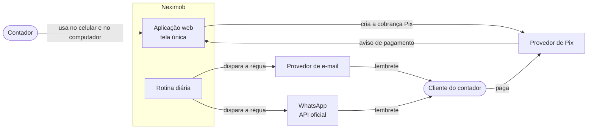
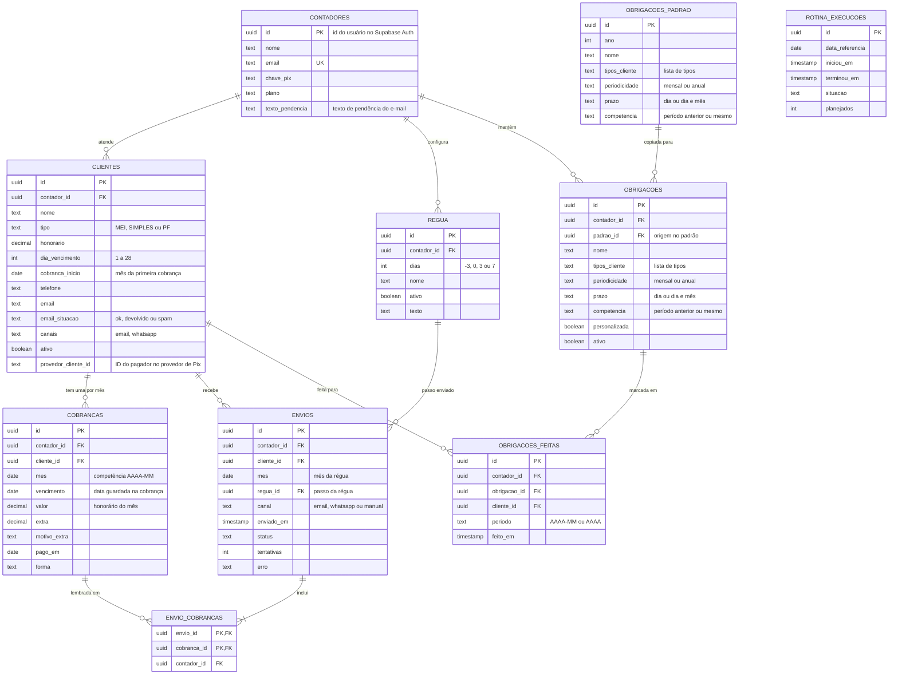

# SRS: Neximob

**Especificação de Requisitos de Software**

| | |
|---|---|
| **Produto** | Neximob |
| **Repositório** | `neximob` |
| **Versão** | 1.8, rascunho para validação |
| **Data** | 12/11/2026 |
| **Fontes** | *Agenda Contábil: Documentação do Produto* e *Agenda Contábil: Briefing para desenvolvimento*, ambos de 03/11/2026, de William Henrique Moreira Dias |
| **Documentos relacionados** | [PRD](./PRD.md) · [Mapa de fluxo](./Mapa%20de%20fluxo.md) · [Arquitetura](./Arquitetura.md) · [API](./API.md) · [Decisões de arquitetura (ADR)](./adr/README.md) |

---

## 1. Introdução

### 1.1 Propósito

Este documento especifica os requisitos funcionais, os requisitos não funcionais, as regras de negócio e o modelo de dados do Neximob. Ele orienta a construção da versão final a partir do protótipo e serve de base para os testes de aceitação. É escrito para quem desenvolve, testa e decide o produto.

### 1.2 Escopo do sistema

O Neximob é uma aplicação web responsiva para o contador autônomo controlar:

- a **cobrança mensal dos honorários** dos clientes, com lembretes automáticos (régua de cobrança) e baixa por Pix;
- o **checklist dos prazos fiscais** dos clientes MEI, Simples Nacional e pessoa física.

Ficam fora: emissão de nota fiscal, integração com a Receita Federal ou o e-CAC, cálculo de impostos e relatórios contábeis.

### 1.3 Convenções

| Convenção | Significado |
|---|---|
| `RF-xx` | Requisito funcional |
| `RNF-xx` | Requisito não funcional |
| `RN-xx` | Regra de negócio |
| `Q-xx` | Questão de produto ou de regra (seção 9) |
| `ADR-xxxx` | Decisão de arquitetura, registrada em [docs/adr](./adr/README.md) |
| **Origem: Decisão** | Decidido pelo responsável do produto; a data está na seção 9.1 |
| **Status: Feito** | Já existe no protótipo. Na versão final precisa ser reimplementado com dados no servidor |
| **Status: Simulado** | A tela existe, mas a ação não acontece de verdade |
| **Status: A fazer** | Falta construir |
| **Status: Em aberto** | Depende de uma decisão de produto |
| **Fase** | F1 Validar · F2 Base · F3 Cobrança real · F4 Pix e WhatsApp · F5 Venda (ver PRD, seção 9) |
| **Origem: Doc** | Documentação do Produto |
| **Origem: Briefing** | Briefing para desenvolvimento |
| **Origem: Proposto** | Acrescentado por este documento; precisa ser validado |

Os códigos que vêm das fontes foram mantidos. Os requisitos novos usam faixas livres (RF-06, RF-24, RF-35, RF-40 em diante, RN-13 em diante, RNF-06 em diante).

Os critérios de aceite seguem o formato **Dado / Quando / Então**.

### 1.4 Definições

O glossário completo está no [PRD](./PRD.md), seção 14. Os termos abaixo têm sentido preciso neste documento:

| Termo | Definição |
|---|---|
| **Mês de referência** | Mês que a tela mostra. Por padrão, o mês corrente |
| **Cobrança** | Registro do honorário de um cliente num mês de referência |
| **Data de vencimento da cobrança** | Dia de vencimento do cliente no mês de referência da cobrança |
| **Valor total da cobrança** | Honorário do mês + serviço extra do mês (RN-01) |
| **Passo** | Um lembrete da régua, definido pelos dias em relação ao vencimento: −3, 0, +3 ou +7 |
| **Data do passo** | Data de vencimento da cobrança + dias do passo |
| **Envio** | Registro de uma mensagem de cobrança mandada, automática ou manualmente |
| **Período da obrigação** | Mês (`AAAA-MM`) para obrigação mensal; ano (`AAAA`) para obrigação anual |
| **Hoje** | Data corrente no fuso de Brasília (RNF-08) |

---

## 2. Descrição geral

### 2.1 Perspectiva do produto

| | Protótipo (hoje) | Versão final |
|---|---|---|
| Tecnologia | Página HTML com JavaScript puro, sem biblioteca | Next.js em TypeScript, hospedado na Cloudflare, com Supabase (Postgres e Auth) em São Paulo (ADR-0001, ADR-0006) |
| Dados | Objeto salvo no navegador (chave de armazenamento com o nome antigo "Prazo Certo") | No servidor, por conta de contador, acessíveis do celular e do computador |
| Clientes | De exemplo | Reais, cadastrados pelo contador |
| Envio de cobrança | Simulado: mensagem pronta para copiar | E-mail e WhatsApp automáticos, pela régua |
| Pagamento | Marcado à mão | Pix com baixa automática, e também à mão |
| Obrigações | Fixas no código, com datas de exemplo | Calendário editável, conferido por um contador |

**Contexto do sistema**



### 2.2 Funções do produto

1. Cadastrar clientes uma vez, com honorário, tipo e dia de vencimento.
2. Gerar, todo mês, a cobrança e as obrigações de cada cliente ativo.
3. Mostrar o resumo do mês: recebido, a receber, clientes em atraso e guias a fazer.
4. Listar as cobranças por status, com filtros, baixa manual e ajuste do valor do mês.
5. Enviar lembretes de cobrança pela régua, de forma automática.
6. Receber por Pix e dar baixa automática.
7. Manter o checklist de obrigações fiscais por cliente.
8. Permitir que o contador configure a régua, a chave Pix e o calendário fiscal.
9. Gerenciar a conta do contador e a assinatura do app.

### 2.3 Usuários e atores

| Ator | Tipo | Descrição |
|---|---|---|
| **Contador** | Usuário | Único usuário autenticado. Cada contador tem sua conta e só vê os próprios dados |
| **Cliente do contador** | Destinatário | Recebe lembretes e paga. Não acessa o app (a página do cliente está em aberto, RF-60) |
| **Rotina diária** | Sistema | Tarefa agendada que verifica vencimentos e dispara o passo certo da régua |
| **Provedores externos** | Sistema | E-mail, WhatsApp (API oficial), Pix e cobrança da assinatura |

### 2.4 Ambiente de operação

- Navegadores atuais, no celular e no computador.
- Interface em português do Brasil, valores em reais.
- Datas calculadas no fuso de Brasília (`America/Sao_Paulo`) **(proposto)**.

### 2.5 Restrições

| # | Restrição | Origem |
|---|---|---|
| C-01 | O app não calcula impostos e não deve prometer isso | Doc, Briefing |
| C-02 | WhatsApp só pela API oficial, com modelos de mensagem aprovados. Disparo automático por número comum pode bloquear o número | Doc (RNF-04), Briefing |
| C-03 | LGPD: o sistema guarda nome, valores e situação fiscal de terceiros. Exige login seguro e consentimento | Doc (RNF-05), Briefing |
| C-04 | Regras fiscais mudam: datas e obrigações devem ser fáceis de atualizar e conferidas por um contador | Briefing |
| C-05 | As regras da seção 4 marcadas como **invioláveis** não podem mudar | Briefing |
| C-06 | Tudo em português, valores em reais, funcionando no celular | Briefing |
| C-07 | A interface deve manter o visual do protótipo: resumo do mês no topo e abas Cobranças, Obrigações e Régua de cobrança | Briefing |

### 2.6 Premissas e dependências

- **Stack decidida (ADR-0001, ADR-0006):** Next.js (React) em TypeScript na interface e nas rotas de servidor, hospedado na Cloudflare (Workers, com o adaptador OpenNext); Supabase para o banco (Postgres) e o login (Auth), na região de São Paulo. A rotina diária roda no Supabase Cron, em duas etapas (ADR-0005). As integrações (e-mail primeiro, depois WhatsApp pela API oficial e Pix por um provedor como o Asaas) terão ADRs próprias.
- O app não guarda CPF nem CNPJ dos clientes; quando o provedor de Pix exigir, o dado fica só nele (ADR-0003).
- O contador tem uma chave Pix.
- Os clientes têm e-mail ou celular para receber os lembretes.
- Cada contador tem poucos clientes. **(proposto)** A especificação considera até algumas centenas por conta.

---

## 3. Requisitos funcionais

### 3.1 Visão geral

| Código | Requisito | Status | Fase | Origem |
|---|---|---|---|---|
| RF-01 | Cadastrar cliente com nome, tipo, honorário mensal e dia de vencimento | Feito | F2 | Doc |
| RF-02 | Ao cadastrar, a cobrança e os prazos do cliente passam a valer todo mês | Feito | F2 | Doc |
| RF-03 | Resumo do mês: recebido (com barra de %), a receber, clientes em atraso e guias a fazer | Feito | F2 | Doc |
| RF-04 | Editar e excluir cliente | A fazer | F2 | Doc |
| RF-05 | Telefone e e-mail do cliente para envio da cobrança | A fazer | F2 | Doc |
| RF-06 | Inativar e reativar cliente | A fazer | F2 | Decisão (Q-15) |
| RF-10 | Status do cliente no mês: Pago, Vence dia X, Vence hoje, Atrasado há N dias | Feito | F2 | Doc |
| RF-11 | Filtros e ordem da lista de cobranças | Feito | F2 | Doc |
| RF-12 | Marcar como pago e desfazer | Feito | F2 | Doc |
| RF-13 | Ajustar o valor só do mês com serviço extra e motivo | Feito | F2 | Doc |
| RF-14 | Mostrar a mensagem do passo certo da régua, copiar e registrar o envio | Simulado | F2 | Doc |
| RF-15 | Mostrar a data do próximo lembrete automático | Feito | F2 | Doc |
| RF-16 | Enviar a cobrança de verdade por e-mail e WhatsApp | A fazer | F3 (e-mail), F4 (WhatsApp) | Doc |
| RF-17 | Cobrança por Pix com baixa automática | A fazer | F4 | Doc |
| RF-18 | Histórico dos meses anteriores | A fazer | **(proposto)** F3 | Doc |
| RF-20 | Obrigações por tipo de cliente | Feito, datas de exemplo | F2 | Doc |
| RF-21 | Checklist por obrigação com "X de Y feitos" e barra de progresso | Feito | F2 | Doc |
| RF-22 | Aviso de prazo: vencida, vence hoje ou faltam N dias | Feito | F2 | Doc |
| RF-23 | Tela para o contador cadastrar e corrigir obrigações e datas | A fazer | F5 | Doc |
| RF-24 | Próximos prazos do ano | Feito, datas de exemplo | F2 | Doc (mapa de telas) |
| RF-30 | Régua com 4 passos: 3 dias antes, no dia, 3 dias depois e 7 dias depois | Feito | F2 | Doc |
| RF-31 | Ligar e desligar cada passo e editar o texto | Feito | F2 | Doc |
| RF-32 | Campos na mensagem: `{nome}`, `{mes}`, `{valor}`, `{venc}`, `{pix}` | Feito | F2 | Doc |
| RF-33 | Chave Pix do contador e prévia da mensagem com um cliente de exemplo | Feito | F2 | Doc |
| RF-34 | Rotina diária no servidor que dispara o passo certo | A fazer | F3 | Doc |
| RF-35 | Registro dos envios, com passo, canal, data e status | A fazer | F3 | Briefing |
| RF-40 | Criar conta e entrar por e-mail | A fazer | F2 | Briefing |
| RF-41 | Uma conta por contador, com dados isolados | A fazer | F2 | Briefing |
| RF-42 | Perfil do contador: nome, e-mail, chave Pix e plano | A fazer | F2 | Briefing |
| RF-43 | Aceite dos termos e consentimento (LGPD) | A fazer | F2 | Doc (RNF-05) |
| RF-44 | Exportar e excluir os dados da conta | A fazer | F2 | Proposto |
| RF-45 | Sair da conta e recuperar o acesso | A fazer | F2 | Decisão (ADR-0008) |
| RF-50 | Assinatura mensal do app | A fazer | F5 | Briefing |
| RF-60 | Página do cliente para ver e pagar o honorário | Em aberto | — | Briefing |

### 3.2 Clientes e resumo

#### RF-01 · Cadastrar cliente

O contador cadastra um cliente pelo botão **+ Novo cliente**, no topo da tela.

| Campo | Regra |
|---|---|
| Nome | Obrigatório |
| Tipo | Obrigatório: `MEI`, `Simples` ou `PF` |
| Honorário mensal | Obrigatório, em reais. **(proposto)** Maior que zero, com duas casas decimais |
| Dia de vencimento | Obrigatório, inteiro de 1 a 28 (RN-07) |
| Telefone e e-mail | Ver RF-05 |
| Canais de envio | Por padrão, todos os canais com contato cadastrado; o contador pode escolher os canais do cliente (Q-05) |
| Início da cobrança | Só aparece quando o dia de vencimento deste mês já passou: "este mês" (a cobrança já nasce atrasada) ou "próximo mês" (padrão) (RN-21) |

**Critérios de aceite**
- Dado o formulário preenchido com dia de vencimento 29, 30 ou 31, quando o contador salva, então o sistema não salva e informa que o dia deve estar entre 1 e 28.
- Dado um cadastro válido, quando o contador salva, então o cliente aparece na aba Cobranças do mês de referência e no checklist das obrigações do seu tipo (RF-02, RN-10).
- Dado que hoje é dia 15 e o contador cadastra um cliente com vencimento no dia 10, quando salva sem mudar a opção padrão, então a primeira cobrança é a do mês seguinte, e as obrigações do tipo já entram no checklist deste mês (RN-21).

#### RF-02 · Cobrança e prazos todo mês

A cada mês, todo cliente ativo tem:
- uma **cobrança** com o honorário vigente e o serviço extra zerado (RN-01, RN-15);
- as **obrigações** do seu tipo no checklist (RN-10).

**Critérios de aceite**
- Dado um cliente ativo, quando começa um novo mês, então existe uma cobrança dele nesse mês, com o honorário vigente e sem serviço extra.
- Dado um cliente com serviço extra no mês anterior, quando começa o novo mês, então o extra não é repetido.
- Dado um cliente inativo (RF-06), quando começa um novo mês, então nenhuma cobrança nem obrigação é gerada para ele.

**Quando a cobrança passa a existir.** A cobrança de cada mês é criada no dia 1 ou na data do primeiro passo ligado da régua, o que vier antes. Exemplo: para um cliente com vencimento no dia 2, a cobrança de dezembro já existe em 29/11, dia do lembrete "3 dias antes". A primeira cobrança do cliente é a do mês de início escolhido no cadastro (RN-21).

#### RF-03 · Resumo do mês

Quatro cards no topo da tela, calculados para o mês de referência:

| Card | Cálculo |
|---|---|
| **Recebido** | Soma do valor total (RN-01) das cobranças pagas. A barra mostra Recebido ÷ (Recebido + A receber) |
| **A receber** | Soma do valor total das cobranças não pagas do mês de referência. **(proposto)** Logo abaixo, numa linha separada, o total em aberto de meses anteriores (RN-18) |
| **Clientes em atraso** | Quantidade de clientes com alguma cobrança atrasada (RN-02), do mês de referência ou de meses anteriores (RN-18) |
| **Guias a fazer no mês** | Quantidade de pares (obrigação, cliente) com prazo no mês de referência e ainda não marcados como feitos |

> Os cálculos acima são a interpretação deste documento e devem ser conferidos no protótipo. Em particular: "Recebido" considera o mês da cobrança, e não a data do pagamento.

**Critérios de aceite**
- Dado um mês com R$ 1.000,00 recebidos e R$ 500,00 a receber, quando a tela carrega, então o card Recebido mostra R$ 1.000,00 e a barra marca 67%.
- Dado que o contador marca uma cobrança como paga, quando a ação termina, então os quatro cards se atualizam sem recarregar a página.
- Dado que um cliente pagou novembro mas não pagou outubro, quando a tela de novembro carrega, então ele conta em "Clientes em atraso".

#### RF-04 · Editar e excluir cliente

- O contador edita todos os campos do RF-01 e do RF-05.
- **(proposto)** A mudança de honorário vale para as cobranças ainda não pagas do mês corrente em diante; cobranças pagas não mudam (RN-14).
- **Inativar** (RF-06) é a ação padrão para tirar um cliente da carteira, porque mantém o histórico (Q-15).
- **Excluir** pede confirmação e apaga o cliente com suas cobranças, envios e obrigações feitas (direito de eliminação da LGPD) (Q-15).

**Critérios de aceite**
- Dado um cliente com cobrança paga em outubro, quando o contador muda o honorário em novembro, então a cobrança de outubro mantém o valor original.
- Dado que o contador pede para excluir um cliente, quando confirma, então o cliente some de todas as abas e do resumo.

#### RF-05 · Telefone e e-mail

- Campos opcionais no cadastro, usados para enviar a cobrança.
- **(proposto)** E-mail com formato válido. Telefone celular brasileiro com DDD, guardado no formato internacional (+55...).
- **(proposto)** Cliente sem nenhum contato não recebe envio automático e aparece com o aviso "sem contato" na lista (RN-17). A mensagem pronta para copiar (RF-14) continua disponível.
- **(proposto)** E-mail que voltou (devolução definitiva) ou que o cliente marcou como spam fica sinalizado no cadastro e deixa de receber lembretes automáticos até o contador corrigir o endereço (RN-24, ADR-0007).
- Por padrão, o cliente recebe os lembretes por todos os canais com contato cadastrado. O contador pode desligar um canal para um cliente específico (Q-05).

#### RF-06 · Inativar e reativar cliente

Usa o campo `ativo` do modelo de dados. Inativar é a ação padrão para tirar um cliente da carteira (Q-15).
- Cliente inativo não gera cobrança, não recebe lembretes e não entra no checklist (RN-16).
- O histórico do cliente é mantido.
- Reativar volta a gerar cobrança e obrigações a partir do mês corrente.

### 3.3 Cobranças

#### RF-10 · Status no mês

Cada cobrança mostra um status, calculado pela RN-02:

| Status | Rótulo na tela |
|---|---|
| Pago | **Pago** |
| A vencer | **Vence dia X** |
| Vence hoje | **Vence hoje** |
| Atrasado | **Atrasado há N dias** |

**Critérios de aceite**
- Dado um cliente com vencimento no dia 10, sem pagamento, quando hoje é dia 7, então o status é "Vence dia 10".
- Dado o mesmo cliente, quando hoje é dia 10, então o status é "Vence hoje".
- Dado o mesmo cliente, quando hoje é dia 15, então o status é "Atrasado há 5 dias".
- Dado o mesmo cliente com pagamento registrado, quando a tela carrega em qualquer dia, então o status é "Pago".

#### RF-11 · Filtros e ordem

- Filtros: **Todos**, **Em atraso**, **A vencer**, **Pagos**.
- Ordem da lista: atrasados, vence hoje, a vencer, pagos.
- **(proposto)** Dentro de cada grupo: atrasados com mais dias primeiro; a vencer pela data mais próxima; pagos pela data de pagamento mais recente.
- **(proposto)** "A vencer" inclui as cobranças que vencem hoje.
- **(proposto)** Cliente com cobrança de mês anterior em aberto mostra o selo "N meses em aberto" e entra no filtro **Em atraso**, mesmo que o mês corrente esteja pago (RN-18).

#### RF-12 · Marcar como pago e desfazer

- **Marcar como pago** registra a data do pagamento (`pago_em`) e a forma (`forma`).
- **(proposto)** Formas para baixa manual: Pix, transferência, dinheiro, outro. Data padrão: hoje, editável.
- **Desfazer** apaga a data e a forma; o status volta a ser calculado pela RN-02.
- Depois de pago, nenhum passo da régua é enviado para essa cobrança (RN-09).

**Critérios de aceite**
- Dado que a cobrança está atrasada, quando o contador marca como pago, então o status vira "Pago" e o resumo se atualiza.
- Dado que a cobrança está paga, quando o contador desfaz, então o status volta ao calculado e a régua volta a valer para os passos futuros.

#### RF-13 · Ajustar o valor do mês

- O contador informa o **valor do serviço extra** e o **motivo**.
- O valor do mês passa a ser honorário + extra (RN-01). O honorário fixo do cliente não muda.
- O extra vale só para a cobrança daquele mês (RN-15).
- **(proposto)** Extra maior ou igual a zero; motivo obrigatório quando o extra for maior que zero. Zerar o extra desfaz o ajuste.

**Critérios de aceite**
- Dado um cliente com honorário de R$ 300,00, quando o contador lança R$ 150,00 de extra com o motivo "Abertura de filial", então a cobrança do mês mostra R$ 450,00 e o honorário do cadastro continua R$ 300,00.
- Dado o ajuste acima, quando começa o mês seguinte, então a nova cobrança é de R$ 300,00.

#### RF-14 · Mensagem pronta para cobrar

- O botão **Cobrar** mostra a mensagem do passo certo para o status da cobrança (RN-03), com os campos preenchidos (RN-11).
- O contador pode **copiar** a mensagem e **registrar o envio**.
- Se o cliente tiver pendências de meses anteriores, a mensagem traz também o bloco de pendências (RN-19).
- O botão usa o texto do passo mesmo que ele esteja desligado na régua: desligar um passo só impede o envio automático (Q-03).
- No protótipo, o registro é simulado. Na versão final, o registro cria um envio com o canal "manual" (RF-35).

#### RF-15 · Próximo lembrete automático

- Cada cobrança não paga mostra a data do próximo lembrete, calculada pela RN-04.
- **(proposto)** Se não houver próximo lembrete (cobrança paga, todos os passos já passaram ou estão desligados), a tela mostra "Sem próximos lembretes".

#### RF-16 · Envio real por e-mail e WhatsApp

| | E-mail (F3) | WhatsApp (F4) |
|---|---|---|
| Disparo | Rotina diária (RF-34) | Rotina diária (RF-34) |
| Conteúdo | Texto do passo da régua, editável pelo contador, com os campos preenchidos | Modelo fixo da plataforma, aprovado na Meta, com os campos como variáveis. O contador não edita o texto (ADR-0002) |
| Requisitos do canal | Resend (ADR-0007). Remetente no domínio da plataforma, com o nome do contador, e resposta (Reply-To) para o e-mail do contador | API oficial; **(proposto)** consentimento (opt-in) do cliente para receber mensagens |
| Registro | Cada tentativa gera um envio (RF-35) | Cada tentativa gera um envio (RF-35) |

Cada mensagem leva a cobrança do mês e as pendências de meses anteriores, se houver. O cliente recebe no máximo uma mensagem por dia em cada canal (RN-18, RN-19).

Os canais de cada cliente seguem o RF-05: por padrão, todos os que têm contato cadastrado (Q-05).

> Por que o texto do WhatsApp não é editável: ver ADR-0002. Número que envia as mensagens: ver Q-16.

#### RF-17 · Pix com baixa automática

- Para cada cobrança não paga, o sistema gera uma cobrança Pix no provedor, com o valor total (RN-01).
- **(proposto)** A mensagem do lembrete traz o Pix copia e cola ou um link de pagamento, além da chave Pix do contador.
- Quando o provedor avisa que o pagamento foi feito, o sistema marca a cobrança como paga, com forma "Pix" e a data do pagamento. A régua para (RN-09).
- **(proposto)** Aviso de pagamento repetido não gera baixa duplicada.
- Valor pago diferente do valor total: a cobrança fica marcada para revisão do contador e não recebe baixa automática (Q-13).
- **(proposto)** Se o contador der baixa manual numa cobrança com Pix em aberto, o sistema cancela a cobrança no provedor.
- **CPF/CNPJ (ADR-0003):** quando o provedor exigir, o contador informa o CPF ou o CNPJ no cadastro do cliente. O servidor repassa o dado ao provedor e guarda só o identificador do pagador. O documento nunca é gravado no banco, em logs ou no navegador (RN-20).
- **(proposto)** Cliente sem cadastro no provedor: a mensagem usa a chave Pix do contador, e a baixa continua manual.
- **(proposto)** Com pendências, o Pix da mensagem cobra o total em aberto, e o pagamento dá baixa em todas as cobranças incluídas (Q-17).

> O provedor ainda não foi escolhido (Asaas ou similar). Em que conta o dinheiro cai: ver Q-18.

#### RF-18 · Histórico dos meses anteriores

- O contador troca o mês de referência no topo e vê as cobranças, os status, os valores, os envios e as obrigações feitas de meses anteriores.
- Cobranças não pagas de meses anteriores continuam com status "Atrasado há N dias", contado a partir do vencimento delas (RN-02). Elas **aparecem no mês corrente e continuam recebendo lembretes até serem pagas** (decisão da Q-02, RN-18).
- **(proposto)** O contador pode dar baixa numa cobrança de mês anterior.

### 3.4 Obrigações

#### RF-20 · Obrigações por tipo de cliente

Calendário padrão do protótipo (datas de exemplo):

| Obrigação | Tipo de cliente | Periodicidade | Prazo no protótipo | Competência mostrada (RN-23) |
|---|---|---|---|---|
| DAS-MEI | MEI | Mensal | Dia 20 | Mês anterior |
| DAS do Simples | Simples | Mensal | Dia 20 | Mês anterior |
| DEFIS | Simples | Anual | Data de exemplo | Ano anterior |
| DASN-SIMEI | MEI | Anual | Data de exemplo | Ano anterior |
| IRPF | PF | Anual | Data de exemplo | Ano anterior (ano-calendário) |

Cada obrigação é rotulada pelo vencimento e mostra a competência, por exemplo: "DAS-MEI · vence 20/11 · competência outubro" (Q-07).

> As datas e as competências precisam ser conferidas por um contador antes do lançamento. Desde a F2, as obrigações ficam no banco de dados, e não no código, para que o RF-23 seja só uma tela nova (RNF-11). O calendário padrão é publicado pela plataforma a cada ano (Q-08).

#### RF-21 · Checklist por obrigação

- Cada obrigação do período mostra a lista dos clientes do tipo correspondente, com "X de Y feitos" e uma barra de progresso.
- O contador marca e desmarca cada cliente como feito no período (RN-06). Marcar registra a data (`feito_em`).

**Critérios de aceite**
- Dado que há 4 clientes MEI ativos, quando o contador marca 3 deles no DAS-MEI do mês, então a obrigação mostra "3 de 4 feitos" e a barra marca 75%.
- Dado o DAS-MEI do mês com 3 de 4 feitos, quando muda o mês, então o checklist do novo mês começa em "0 de 4 feitos".
- Dado que a DASN-SIMEI foi marcada para um cliente, quando muda o mês dentro do mesmo ano, então a marcação continua valendo.

#### RF-22 · Aviso de prazo

Cada obrigação mostra um aviso, comparando o prazo com hoje:
- **Vencida**, se o prazo já passou;
- **Vence hoje**;
- **Faltam N dias**.

**(proposto)** Obrigação com todos os clientes feitos não mostra o aviso de vencida.

O prazo exibido é a data cadastrada no calendário. O app não ajusta sozinho as datas que caem em fim de semana ou feriado; quando a regra de uma obrigação prorrogar o prazo, a correção é feita no calendário (RF-23), conferida por um contador (Q-06).

#### RF-23 · Calendário fiscal editável

- O contador cadastra, edita, desativa e exclui obrigações.
- Campos: nome, tipos de cliente a que se aplica, periodicidade (mensal ou anual), prazo (dia, para mensal; dia e mês, para anual) e competência mostrada (período anterior ou o mesmo período do prazo, RN-23).
- A mudança se reflete no checklist e no resumo do mês.

**Calendário padrão e ajustes do contador (Q-08)**
- A plataforma mantém o calendário padrão (`obrigacoes_padrao`) e publica a versão de cada ano, conferida por um contador.
- Na criação da conta, o calendário padrão é copiado para a conta do contador (RF-42).
- O contador pode ajustar qualquer obrigação na própria conta. A obrigação ajustada fica marcada como personalizada.
- **(proposto)** Quando a plataforma publica um padrão novo, as obrigações não personalizadas são atualizadas sozinhas. Nas personalizadas, o contador recebe um aviso e escolhe se aplica a mudança.

#### RF-24 · Próximos prazos do ano

A aba Obrigações mostra, além do checklist do mês, os próximos prazos do ano (obrigações anuais e mensais futuras), em ordem de data.

### 3.5 Régua de cobrança

#### RF-30 · Os quatro passos

| Passo | Dias em relação ao vencimento | Padrão | Uso |
|---|---|---|---|
| 3 dias antes | −3 | Ligado | Lembrete com a chave Pix |
| No dia | 0 | Ligado | Lembrete no dia do vencimento |
| 3 dias depois | +3 | Ligado | Cobrança que pede o comprovante |
| 7 dias depois | +7 | Desligado | Última cobrança da régua |

#### RF-31 · Ligar, desligar e editar

- Cada passo pode ser ligado ou desligado.
- O texto de cada passo pode ser editado. **A edição vale para o e-mail.** No WhatsApp, os textos são modelos fixos aprovados na Meta, e a aba mostra a prévia do WhatsApp sem edição (ADR-0002).
- Texto de pendência, também editável para o e-mail, usado quando só restam cobranças de meses anteriores em aberto (RN-18). Nele valem os campos `{nome}` e `{pix}`; os meses e o total vêm no bloco que o sistema acrescenta.
- **(proposto)** Botão para restaurar o texto padrão.

#### RF-32 · Campos da mensagem

| Campo | Conteúdo | Formato (Q-11) |
|---|---|---|
| `{nome}` | Primeiro nome do cliente (RN-05) | "Maria" para "Maria Souza" |
| `{mes}` | Mês de referência da cobrança | Por extenso: "novembro" |
| `{valor}` | Valor total da cobrança (RN-01) | "R$ 1.234,56" |
| `{venc}` | Data de vencimento da cobrança | "10/11" |
| `{pix}` | Chave Pix do contador | Como cadastrada |

No WhatsApp, os mesmos campos viram as variáveis do modelo aprovado (ADR-0002). O bloco de pendências (RN-19) é acrescentado pelo sistema, sem campo novo.

**(proposto)** Ao editar o texto, um campo desconhecido (por exemplo, `{nomee}`) gera um aviso antes de salvar.

#### RF-33 · Chave Pix e prévia

- O contador informa a chave Pix, que preenche o campo `{pix}`.
- Cada passo mostra uma prévia da mensagem com um cliente de exemplo.

#### RF-34 · Rotina diária

Uma vez por dia, às 9h no fuso de Brasília (Q-10):

1. Seleciona os clientes **ativos** com alguma cobrança **não paga**, do mês corrente ou de meses anteriores (RN-09, RN-16, RN-18).
2. Para cada passo **ligado**, verifica se hoje é a data desse passo para algum vencimento do cliente. Esse vencimento pode ser de outro mês: o passo "3 dias antes" de quem vence no dia 2 cai no mês anterior, e os passos "3 dias depois" e "7 dias depois" de quem vence no fim do mês caem no mês seguinte (seção 4.3).
3. Se esse passo ainda não foi enviado ao cliente para aquele mês e por aquele canal (RN-13), monta **uma única mensagem** com a cobrança do mês e as pendências (RN-19) e envia pelos canais do cliente (RF-05).
4. Se a cobrança do mês já foi paga e só restam pendências, envia só no passo "No dia", com o texto de pendência.
5. Registra cada tentativa como envio (RF-35), com as cobranças incluídas na mensagem.
6. Se a rotina deixou de rodar em algum dia, a execução seguinte envia, para cada cliente, só o passo mais recente que ficou para trás. Os anteriores ficam registrados como "pulado" (RN-22, Q-09).

**Implementação (ADR-0005).** A rotina tem duas etapas. Às 9h, uma função no banco planeja os lembretes do dia e grava cada um como envio `pendente`. Em seguida, uma Edge Function envia em lotes. Antes de enviar, a cobrança é conferida de novo: se foi paga depois do planejamento, o envio é cancelado (RN-09). **(proposto)** Os envios só saem entre 9h e 20h de Brasília.

**Critérios de aceite**
- Dado que há uma cobrança não paga com vencimento no dia 10 e o passo −3 está ligado, quando a rotina roda no dia 7, então é enviado o lembrete "3 dias antes".
- Dado que a mesma cobrança foi paga no dia 9 e o cliente não tem pendências, quando a rotina roda no dia 10, então nada é enviado.
- Dado que o cliente não pagou outubro nem novembro, quando a rotina dispara o passo "No dia" de novembro, então ele recebe uma única mensagem com novembro, a pendência de outubro e o total em aberto.
- Dado que o cliente pagou novembro mas não pagou outubro, quando chega o dia de vencimento de novembro, então ele recebe a mensagem de pendência; nos outros passos de novembro, nada é enviado.
- Dado o passo +7 desligado, quando a rotina roda no dia 17, então nada é enviado.
- Dado que a rotina já rodou hoje, quando ela roda de novo no mesmo dia, então nenhum cliente recebe a mesma mensagem duas vezes (mesmo passo e canal).
- Dado um cliente com vencimento no dia 2 e o passo −3 ligado, quando a rotina roda em 29/11, então é enviado o lembrete "3 dias antes" da cobrança de dezembro.
- Dado um cliente com vencimento no dia 10 e a rotina parada dos dias 7 a 10, quando ela volta a rodar no dia 11, então o cliente recebe só a mensagem do passo "No dia", e o passo "3 dias antes" fica registrado como pulado.
- Dado que um lembrete foi planejado às 9h e a cobrança foi paga às 9h02, quando a etapa de envio processa a fila, então o envio fica como cancelado e nada é enviado.

#### RF-35 · Registro dos envios

- Cada envio guarda: cliente, mês da régua, passo, canal (e-mail, WhatsApp ou manual), data e hora, status e as cobranças incluídas na mensagem.
- Status (ADR-0005): `pendente`, `enviando`, `enviado`, `falhou`, `pulado` (passo que ficou para trás, RN-22), `cancelado` (cobrança paga antes do envio) e, quando o provedor informar, `entregue` e `lido`. No e-mail, os avisos do Resend mudam o envio para `entregue` ou, em caso de devolução ou spam, para `falhou` (ADR-0007).
- **(proposto)** Erro temporário gera até 3 novas tentativas. Erro definitivo (endereço inválido, número inexistente) fica como `falhou` na hora.
- O contador vê os envios de cada cobrança. **(proposto)** Envios com falha aparecem em destaque.

### 3.6 Conta, acesso e privacidade

#### RF-40 · Criar conta e entrar por e-mail

- O contador cria a conta e entra com **e-mail e senha** (ADR-0008).
- O primeiro acesso exige a confirmação do e-mail.
- Senha com no mínimo 8 caracteres.
- Os e-mails de login são enviados pelo Supabase Auth através do SMTP do Resend (ADR-0007).

#### RF-41 · Uma conta por contador

- Cada contador vê e altera somente os próprios clientes, cobranças, envios, régua e obrigações. O isolamento é garantido no banco (RNF-06, ADR-0004).
- Na F2, cada conta tem um único usuário. O uso da mesma conta por mais de uma pessoa do escritório será reavaliado depois da validação (Q-14).

#### RF-42 · Perfil do contador

- Nome, e-mail, chave Pix e plano.
- No primeiro acesso, a régua padrão (RF-30) e o calendário padrão da plataforma (RF-20, Q-08) são copiados para a conta.

#### RF-43 · Termos e consentimento (LGPD)

- **(proposto)** No cadastro, o contador aceita os termos de uso e a política de privacidade. O sistema guarda a data e a versão aceitas.
- **(proposto)** A política explica que o contador é o controlador dos dados dos clientes e o Neximob é o operador.

#### RF-44 · Exportar e excluir dados (proposto)

- O contador exporta os dados da conta (clientes, cobranças, envios, obrigações) num arquivo.
- O contador exclui a conta e todos os dados.

#### RF-45 · Sair e recuperar o acesso

- Sair da conta no aparelho atual.
- "Esqueci minha senha" envia um link por e-mail, que abre uma tela para criar uma senha nova (ADR-0008).
- Trocar a senha exige login recente.

**Critérios de aceite**
- Dado um cadastro novo, quando o contador tenta entrar antes de confirmar o e-mail, então o acesso é recusado com a orientação de confirmar o e-mail.
- Dado que o contador pediu a recuperação, quando abre o link recebido e cria uma senha nova, então entra com a senha nova e a antiga deixa de funcionar.

### 3.7 Assinatura

#### RF-50 · Assinatura mensal do app

- O contador assina um plano mensal.
- Preço, período de teste e o que acontece quando a assinatura não é paga ainda estão em aberto (PRD, seção 12).
- Só entra depois de provar que o contador usa o app (F5).

### 3.8 Página do cliente

#### RF-60 · Página para o cliente ver e pagar (em aberto)

Uma página em que o cliente do contador vê o honorário e paga. A decisão está em aberto (PRD, seção 12) e afeta o RF-17.

---

## 4. Regras de negócio

As regras marcadas como **invioláveis** estão na seção 6 do Briefing e não podem mudar sem uma decisão de produto registrada.

| Código | Regra | Inviolável | Origem | Requisitos |
|---|---|---|---|---|
| RN-01 | Valor do mês = honorário fixo + serviço extra do mês | Sim | Doc, Briefing | RF-03, RF-13, RF-17 |
| RN-02 | Status: pago; senão, pela data de vencimento: a vencer, vence hoje ou atrasado há N dias | Sim | Doc, Briefing | RF-10, RF-11 |
| RN-03 | Mensagem usada no botão Cobrar: atrasado → "3 dias depois"; vence hoje → "No dia"; a vencer → "3 dias antes". O texto é usado mesmo que o passo esteja desligado | Não | Doc, Decisão (Q-03) | RF-14 |
| RN-04 | Próximo lembrete = primeiro passo ligado da régua com data de hoje em diante | Não | Doc | RF-15 |
| RN-05 | `{nome}` usa só o primeiro nome do cliente | Sim | Doc, Briefing | RF-32 |
| RN-06 | Obrigação mensal vale para o mês atual; anual vale para o ano da entrega | Não | Doc | RF-21 |
| RN-07 | Dia de vencimento limitado a 1–28, para existir em todos os meses | Sim | Doc, Briefing | RF-01, RF-04 |
| RN-08 | Régua padrão: 3 dias antes, no dia e 3 dias depois ligados; 7 dias depois desligado | Sim | Briefing | RF-30, RF-42 |
| RN-09 | A régua só dispara para quem não pagou | Sim | Briefing | RF-12, RF-17, RF-34 |
| RN-10 | Obrigações por tipo: MEI → DAS-MEI e DASN-SIMEI; Simples → DAS e DEFIS; PF → IRPF | Sim | Briefing | RF-02, RF-20 |
| RN-11 | Campos da mensagem: `{nome}`, `{mes}`, `{valor}`, `{venc}`, `{pix}` | Sim | Briefing | RF-32 |
| RN-12 | O app não calcula impostos e não deve prometer isso | Sim | Briefing | Todo o produto |
| RN-13 | Cada passo da régua é enviado no máximo uma vez por cliente, mês e canal | Não | Proposto | RF-34, RF-35 |
| RN-14 | Cobrança paga não muda de valor; a mudança de honorário vale para as cobranças não pagas do mês corrente em diante | Não | Proposto | RF-04 |
| RN-15 | O serviço extra não passa para o mês seguinte | Sim | Briefing ("só daquele mês") | RF-02, RF-13 |
| RN-16 | Cliente inativo não gera cobrança, não recebe lembrete e não entra no checklist | Não | Decisão (Q-15) | RF-06, RF-34 |
| RN-17 | Cliente sem e-mail e sem telefone não recebe envio automático, e o app avisa o contador | Não | Proposto | RF-05, RF-34 |
| RN-18 | Cobrança não paga de mês anterior continua em aberto: aparece no mês corrente, conta em "Clientes em atraso" e continua recebendo lembretes até ser paga | Não | Decisão (Q-02) | RF-03, RF-11, RF-18, RF-34 |
| RN-19 | O cliente recebe no máximo uma mensagem por dia em cada canal. A cobrança do mês e as pendências vão juntas, com o total em aberto. Se só restam pendências, a mensagem sai uma vez por mês, no dia do vencimento | Não | Decisão (Q-02) | RF-14, RF-16, RF-34 |
| RN-20 | O app não guarda CPF nem CNPJ dos clientes. Esses dados ficam só no provedor de Pix | Não | Decisão (Q-12) | RF-17, RNF-16 |
| RN-21 | Cliente cadastrado depois do dia de vencimento do mês corrente: o contador escolhe se a cobrança começa neste mês (já atrasada) ou no próximo; o padrão é o próximo. As obrigações entram no checklist desde o mês do cadastro | Não | Decisão (Q-01) | RF-01, RF-02 |
| RN-22 | Se a rotina diária deixar de rodar, a execução seguinte envia, para cada cliente, só o passo mais recente que ficou para trás; os anteriores ficam registrados como pulados | Não | Decisão (Q-09) | RF-34, RF-35 |
| RN-23 | A obrigação é rotulada pelo vencimento e mostra a competência: mês anterior para DAS-MEI e DAS; ano anterior para DEFIS, DASN-SIMEI e IRPF | Não | Decisão (Q-07) | RF-20, RF-21, RF-23 |
| RN-24 | E-mail devolvido de forma definitiva ou marcado como spam deixa de receber lembretes automáticos até o contador corrigir o endereço | Não | Proposto (ADR-0007) | RF-05, RF-34, RF-35 |

### 4.1 Detalhe da RN-02 (status)

No protótipo, o status compara só o **dia** de vencimento com o dia de hoje, o que funciona apenas para o mês corrente. Com o histórico (RF-18), a regra passa a comparar **datas**, sem mudar o resultado no mês corrente:

```text
vencimento = data(ano_ref, mes_ref, cliente.dia_vencimento)

se cobranca.pago_em existe     → Pago
senão se hoje < vencimento     → A vencer     ("Vence dia X")
senão se hoje = vencimento     → Vence hoje
senão                          → Atrasado     ("Atrasado há N dias", N = hoje − vencimento)
```

### 4.2 Detalhe da RN-03 e da RN-04 (régua)

```text
# RN-03: passo usado na mensagem manual (botão Cobrar)
Atrasado    → passo +3 ("3 dias depois")
Vence hoje  → passo  0 ("No dia")
A vencer    → passo −3 ("3 dias antes")

# RN-04: próximo lembrete automático (só para cobrança não paga)
proximo = menor (vencimento + p.dias)
          entre os passos p ligados
          com vencimento + p.dias ≥ hoje
```

### 4.3 Detalhe da RN-18, da RN-19 e da RN-22 (rotina diária e pendências)

A régua roda por **cliente**. As cobranças de meses anteriores não ganham uma régua própria: elas entram nas mensagens do mês. Assim, o número de mensagens fica limitado, por mais meses que estejam em aberto.

Para cada passo, a rotina descobre a qual vencimento ele se refere hoje (o **alvo**). O alvo pode ser de outro mês: o passo −3 de quem vence no dia 2 cai no fim do mês anterior, e os passos +3 e +7 de quem vence no fim do mês caem no início do mês seguinte.

```text
# Rotina diária: para cada cliente ativo, cada passo p ligado e cada canal do cliente
alvo = hoje − p.dias                        # vencimento a que o passo se refere hoje
se dia(alvo) ≠ cliente.dia_vencimento: o passo não acontece hoje
ciclo = mês de alvo                         # pode ser o mês anterior ou o seguinte
se ciclo < cliente.cobranca_inicio: não envia (RN-21)

cobranca   = cobrança do cliente no ciclo (criada se ainda não existir, RF-02)
pendencias = cobranças não pagas de meses anteriores ao ciclo
se (cliente, ciclo, p, canal) já foi enviado ou pulado: não envia (RN-13)

se cobranca não está paga:
    mensagem = texto do passo p + bloco de pendências (se houver)
senão se pendencias e p.dias = 0:
    mensagem = texto de pendência            # só pendências: uma vez por mês
senão:
    não envia
```

Os passos ficam a no máximo 10 dias uns dos outros (de −3 a +7), e dois vencimentos seguidos de um cliente ficam a pelo menos 28 dias. Por isso, um cliente nunca tem dois passos no mesmo dia, e "uma mensagem por dia e canal" (RN-19) acontece naturalmente.

**Recuperação (RN-22).** Se a rotina não rodou em algum dia, a execução seguinte repete o cálculo para cada dia perdido, envia só o passo mais recente de cada cliente e registra os anteriores como `pulado`.

Exemplo de bloco de pendências **(proposto)**: "Também está em aberto: outubro (R$ 300,00). Total em aberto: R$ 600,00."

---

## 5. Modelo de dados

No protótipo, tudo fica num objeto salvo no navegador. Para a versão final, as fontes sugerem as tabelas abaixo, já com os ajustes das decisões registradas. Este é o **modelo lógico**. O **esquema físico** está em `supabase/migrations/`, descrito na [Arquitetura](./Arquitetura.md), seção 4. Os dados de exemplo do protótipo não serão migrados **(proposto)**.

**Isolamento (ADR-0004).** Toda tabela de dados do contador tem a coluna `contador_id`, com RLS, e as chaves estrangeiras entre essas tabelas são compostas (`id` + `contador_id`). As chaves únicas também começam por `contador_id`, para que um contador não descubra, por erro de chave duplicada, que um dado de outro existe. Para o diagrama ficar legível, as ligações com `CONTADORES` aparecem só nas tabelas principais.



| Tabela | Campos principais (fonte) | Restrições e campos acrescentados |
|---|---|---|
| `contadores` | id, nome, e-mail, chave Pix, plano | `id` é o id do usuário no Supabase Auth (ADR-0004). E-mail único. Acrescentado: `texto_pendencia`, o texto de pendência do e-mail (Q-02, RF-31). Acrescentar **(proposto)**: data do aceite dos termos e versão aceita (RF-43), data de criação |
| `clientes` | id, contador, nome, tipo (MEI/Simples/PF), honorário, dia de vencimento (1–28), telefone, e-mail, ativo | `dia_vencimento` entre 1 e 28 (RN-07). `ativo` começa verdadeiro. Valores em reais com duas casas. Acrescentados: `cobranca_inicio`, mês da primeira cobrança (RN-21); `canais`, canais de envio, por padrão todos com contato (Q-05); **(proposto)** `email_situacao`, atualizada pelos avisos do Resend (RN-24); `provedor_cliente_id`, identificador do pagador no provedor de Pix. **Nunca** CPF ou CNPJ (RN-20, ADR-0003) |
| `cobrancas` | id, cliente, mês, valor, extra, motivo do extra, pago em, forma | Uma cobrança por cliente e mês. `valor` guarda o honorário daquele mês (RN-14); `extra` começa em zero; valor total = `valor` + `extra` (RN-01). Acrescentado no esquema físico: `vencimento`, a data de vencimento guardada na cobrança, para que mudar o dia de vencimento do cliente não altere cobranças antigas (RN-14). Acrescentar **(proposto)**: identificador da cobrança no provedor de Pix (RF-17) |
| `envios` | id, cobrança, passo da régua, canal, enviado em, status | Ajustado pela Q-02: o envio é do cliente num mês da régua (`cliente_id`, `mes`), e as cobranças incluídas ficam em `envio_cobrancas`. É também a fila da rotina (ADR-0005): um registro por cliente, mês, passo e canal automático, garantido por chave única (RN-13); as novas tentativas atualizam o mesmo registro. Acrescentados: `tentativas`, `proxima_tentativa_em`, `erro` e o identificador da mensagem no provedor |
| `envio_cobrancas` | Tabela nova | Liga cada envio às cobranças que ele lembrou: a do mês e as pendências (RN-19) |
| `regua` | id, contador, dias (−3, 0, +3, +7), nome, ativo, texto | Um passo por contador e número de dias |
| `obrigacoes_padrao` | Tabela nova (Q-08) | Calendário padrão publicado pela plataforma, por ano. Sem `contador_id`: todos os contadores leem, ninguém escreve pela API (ADR-0004) |
| `obrigacoes` | id, contador, nome, tipos de cliente, mensal ou anual, dia ou data | Cópia do calendário padrão na conta do contador. Mensal: dia de 1 a 31. Anual: dia e mês. Acrescentados: `padrao_id` (origem), `personalizada` (o contador ajustou, Q-08), `competencia` (RN-23) e `ativo` |
| `obrigacoes_feitas` | id, obrigação, cliente, período, feito em | Uma marcação por obrigação, cliente e período. Período `AAAA-MM` (mensal) ou `AAAA` (anual), pela RN-06 |
| `rotina_execucoes` | Tabela nova (ADR-0005) | Uma linha por execução do planejamento: data de referência, início, fim, situação e contagens. Interna da plataforma: sem `contador_id` e fora da API |

> Interpretação deste documento: na tabela `cobrancas`, `valor` é o honorário do mês e `extra` é o serviço extra, guardados separados. O total é a soma dos dois.

---

## 6. Requisitos não funcionais

| Código | Categoria | Requisito | Status | Fase | Origem |
|---|---|---|---|---|---|
| RNF-01 | Usabilidade | Funcionar no celular; no celular, a lista vira cartões | Feito | F2 | Doc |
| RNF-02 | Usabilidade | Tema claro e escuro | Feito | F2 | Doc |
| RNF-03 | Disponibilidade dos dados | Dados guardados no servidor e acessíveis do celular e do computador | A fazer | F2 | Doc |
| RNF-04 | Conformidade | WhatsApp só pela API oficial, com modelos fixos aprovados, para não bloquear o número (ADR-0002) | A fazer | F4 | Doc |
| RNF-05 | Privacidade | LGPD: login seguro e consentimento, porque o sistema guarda dados de terceiros | A fazer | F2 | Doc |
| RNF-06 | Segurança | Um contador nunca acessa dados de outro. O isolamento é garantido no banco, com RLS em todas as tabelas, e coberto por testes automatizados (ADR-0004) | A fazer | F2 | Decisão (ADR-0004) |
| RNF-07 | Segurança | Comunicação só por HTTPS; chaves de provedores fora do código; avisos de pagamento (webhooks) autenticados antes de qualquer baixa | A fazer | F2, F4 | Proposto |
| RNF-08 | Localização | Interface em português do Brasil; valores em reais (R$ 1.234,56); datas em dd/mm/aaaa; status e rotina calculados no fuso de Brasília | A fazer | F2 | Briefing, Proposto (fuso) |
| RNF-09 | Confiabilidade | A rotina diária pode rodar de novo sem enviar mensagens repetidas (RN-13); falhas ficam registradas e visíveis; há alerta se a rotina não rodar (ADR-0005) | A fazer | F3 | Proposto |
| RNF-10 | Desempenho | A tela principal carrega em até 2 segundos numa conexão 4G, com até 300 clientes (meta a validar) | A fazer | F2 | Proposto |
| RNF-11 | Manutenibilidade | Obrigações e datas são dados configuráveis e não exigem nova versão do código para mudar | A fazer | F2 (dados), F5 (tela) | Briefing, Proposto |
| RNF-12 | Continuidade | Backup diário do banco, com retenção mínima de 7 dias. Exige o plano pago do Supabase em produção (ADR-0006) | A fazer | F2 | Proposto |
| RNF-13 | Acessibilidade | Fluxos principais conformes com WCAG 2.1 AA, inclusive contraste nos dois temas | A fazer | F2 | Proposto |
| RNF-14 | Entregabilidade | E-mails enviados de domínio autenticado (SPF, DKIM e DMARC), com rastreamento de abertura e clique desligado (ADR-0007) | A fazer | F3 | Proposto |
| RNF-15 | Auditoria | Registrar quem fez e quando: baixa manual, desfazer baixa e mudança de honorário | A fazer | F2 | Proposto |
| RNF-16 | Privacidade | Coletar só os dados necessários. CPF e CNPJ nunca são gravados: vão direto ao provedor de Pix e não aparecem no banco, em logs, em relatórios de erro, em ferramentas de análise nem no navegador. Coberto por teste (ADR-0003) | A fazer | F2 (coleta mínima), F4 (CPF/CNPJ) | Decisão (Q-12) |

---

## 7. Interfaces externas

| Interface | Fase | Uso | Requisitos |
|---|---|---|---|
| **Interface do usuário** | F2 | Tela única: topo (mês de referência e + Novo cliente), resumo do mês e abas Cobranças, Obrigações e Régua de cobrança. Detalhes no [Mapa de fluxo](./Mapa%20de%20fluxo.md) | RF-01 a RF-35, RNF-01, RNF-02 |
| **Autenticação** | F2 | Login por e-mail com Supabase Auth (ADR-0001) | RF-40 a RF-45 |
| **Agendador** | F3 | Supabase Cron: planejamento às 9h de Brasília e envio em lotes a cada poucos minutos (ADR-0005) | RF-34, RNF-09 |
| **Provedor de e-mail** | F2 (login), F3 (lembretes) | Resend (ADR-0007): SMTP para os e-mails de login do Supabase Auth; API para os lembretes, com chave de idempotência; avisos de entrega, devolução e spam | RF-16, RF-35, RF-40, RNF-14 |
| **WhatsApp (API oficial)** | F4 | Envio dos modelos fixos aprovados (ADR-0002); recebimento do status de entrega e leitura | RF-16, RF-35, RNF-04 |
| **Provedor de Pix** | F4 | Cadastrar o pagador com CPF ou CNPJ, guardados só no provedor (ADR-0003); criar e cancelar cobrança Pix; receber o aviso de pagamento | RF-17, RNF-07, RNF-16 |
| **Cobrança da assinatura** | F5 | Cobrança recorrente do plano do contador | RF-50 |

---

## 8. Rastreabilidade

### 8.1 Objetivos do PRD → requisitos

| Objetivo | Requisitos e regras | Fases |
|---|---|---|
| O1 · Cobrança no piloto automático | RF-15, RF-16, RF-17, RF-30 a RF-35, RN-03, RN-04, RN-08, RN-09, RN-13, RN-18, RN-19, RN-22 | F3, F4 |
| O2 · Saber em segundos quanto entrou e quanto falta | RF-03, RF-10, RF-11, RF-12, RF-13, RF-18, RN-01, RN-02 | F2, F3 |
| O3 · Nenhum prazo fiscal esquecido | RF-20 a RF-24, RN-06, RN-10, RN-23, RNF-11 | F2, F5 |
| O4 · Cadastrar uma vez | RF-01, RF-02, RF-04, RF-05, RF-06, RN-07, RN-15, RN-21 | F2 |

### 8.2 O que falta construir (Briefing, seção 7) → requisitos

| # | Item | Requisitos |
|---|---|---|
| 1 | Login e banco de dados, com cada contador na sua conta | RF-40 a RF-45, RNF-03, RNF-05, RNF-06 |
| 2 | Cadastro completo do cliente | RF-04, RF-05, RF-06 |
| 3 | Envio real da cobrança por e-mail, depois WhatsApp | RF-16, RF-35, RNF-04, RNF-14 |
| 4 | Rotina automática diária | RF-34, RNF-09 |
| 5 | Cobrança por Pix com baixa automática | RF-17, RNF-07 |
| 6 | Calendário fiscal editável | RF-23, RNF-11 |
| 7 | Histórico dos meses anteriores | RF-18 |
| 8 | Assinatura mensal do app | RF-50 |

---

## 9. Decisões e questões em aberto

### 9.1 Decisões tomadas

| # | Questão | Decisão | Data | Onde |
|---|---|---|---|---|
| — | Stack da versão final | Next.js + Supabase (Postgres e Auth) | 07/11/2026 | ADR-0001 |
| Q-02 | Cobranças não pagas de meses anteriores: aparecem no mês corrente? Continuam recebendo lembretes? | Sim. Aparecem no mês corrente, contam em "Clientes em atraso" e continuam recebendo lembretes até serem pagas. Mecanismo, confirmado em 11/11/2026: uma mensagem só, com o mês e o total em aberto; com só pendências, uma mensagem por mês, no dia do vencimento (RN-19) | 07/11/2026 | RN-18, RN-19, seção 4.3 |
| Q-04 | Os textos da régua são editáveis, mas o WhatsApp só envia modelos aprovados. Como conciliar? | Texto livre só no e-mail. No WhatsApp, modelos fixos da plataforma, aprovados na Meta, com os campos como variáveis | 07/11/2026 | ADR-0002 |
| Q-12 | O provedor de Pix exige o CPF ou CNPJ do pagador? | O app não guarda CPF nem CNPJ em nenhuma hipótese. Quando o provedor exigir, o dado vai direto para ele, e o app guarda só o identificador do pagador | 07/11/2026 | ADR-0003, RN-20 |
| — | Isolamento dos dados entre contadores | RLS em todas as tabelas, `contador_id` em todas as tabelas de dados, chaves estrangeiras compostas e testes com dois contadores | 09/11/2026 | ADR-0004 |
| — | Rotina diária | Supabase Cron em duas etapas: planejar no banco e enviar por Edge Function, com a tabela `envios` como fila | 09/11/2026 | ADR-0005 |
| — | Hospedagem, região e linguagem | Next.js na Cloudflare (Workers, adaptador OpenNext), Supabase em São Paulo, TypeScript | 09/11/2026 | ADR-0006 |
| — | Provedor de e-mail | Resend, para os e-mails de login (SMTP) e para os lembretes (API) | 09/11/2026 | ADR-0007 |
| — | Nome do produto | Neximob | 11/11/2026 | PRD, seção 12.1 |
| — | Método de login | E-mail e senha, com confirmação do e-mail e recuperação por e-mail | 11/11/2026 | ADR-0008 |
| Q-01 | Cliente cadastrado depois do dia de vencimento do mês | O cadastro pergunta se a cobrança começa neste mês ou no próximo; o padrão é o próximo | 09/11/2026 | RN-21, RF-01 |
| Q-03 | A mensagem manual usa o texto de um passo desligado? | Sim: desligar um passo só impede o envio automático | 09/11/2026 | RN-03, RF-14 |
| Q-05 | Por qual canal cada cliente recebe? | Todos os canais com contato cadastrado, com opção de escolher por cliente | 09/11/2026 | RF-05, RF-16 |
| Q-06 | Prazo fiscal em fim de semana ou feriado | Mostrar a data cadastrada; o ajuste é feito no calendário, conferido por um contador | 09/11/2026 | RF-22, RF-23 |
| Q-07 | Mês do checklist × competência da guia | Rotular pelo vencimento e mostrar a competência | 09/11/2026 | RN-23, RF-20 |
| Q-08 | Quem mantém o calendário fiscal padrão | A plataforma publica o padrão anual; o contador ajusta na própria conta | 09/11/2026 | RF-23, `obrigacoes_padrao` |
| Q-09 | Rotina diária que deixou de rodar | Enviar só o passo mais recente que ficou para trás | 09/11/2026 | RN-22, RF-34 |
| Q-10 | Horário dos lembretes | 9h, no fuso de Brasília | 09/11/2026 | RF-34 |
| Q-11 | Formato de `{mes}` e `{venc}` | "novembro" e "10/11" | 09/11/2026 | RF-32 |
| Q-13 | Valor pago por Pix diferente do valor total | Marcar para revisão do contador, sem baixa automática | 09/11/2026 | RF-17 |
| Q-14 | Escritório com mais de uma pessoa | Uma conta por contador na F2; reavaliar depois da validação | 09/11/2026 | RF-41, ADR-0004 |
| Q-15 | Excluir ou inativar cliente | Inativar por padrão; excluir apaga tudo, com confirmação | 09/11/2026 | RF-04, RF-06, RN-16 |

### 9.2 Em aberto

As três questões abaixo ficam para a discussão das integrações, antes da F4.

| # | Questão | Sugestão | Afeta |
|---|---|---|---|
| Q-16 | De qual número saem as mensagens de WhatsApp: o de cada contador ou um número único da plataforma? | Decidir junto com o provedor de WhatsApp. O número do contador é reconhecido pelo cliente; um número único é mais simples de operar | RF-16, ADR-0002 |
| Q-17 | Com pendências, o Pix cobra o total em aberto numa cobrança só, ou um Pix por mês? | Um Pix pelo total, que dá baixa em todas as cobranças incluídas | RF-17, RN-19 |
| Q-18 | O dinheiro do Pix cai na conta do contador no provedor ou numa conta da plataforma? | Na conta do contador (própria ou subconta), para que a plataforma nunca receba o dinheiro dos honorários | RF-17 |

---

## 10. Histórico do documento

| Versão | Data | Alteração |
|---|---|---|
| 1.0 | 07/11/2026 | Primeira versão, a partir da Documentação do Produto e do Briefing de 03/11/2026 |
| 1.1 | 07/11/2026 | Decisões: stack (ADR-0001), Q-02, Q-04 (ADR-0002) e Q-12 (ADR-0003). Novas RN-18 a RN-20, seção 4.3, ajuste da tabela `envios` e novas questões Q-16 a Q-18 |
| 1.2 | 09/11/2026 | Isolamento por RLS (ADR-0004) no modelo de dados; decisões das questões Q-01, Q-03, Q-05 a Q-11 e Q-13 a Q-15; novas RN-21 a RN-23; tabela `obrigacoes_padrao`; correção da seção 4.3 para passos que caem em outro mês |
| 1.3 | 09/11/2026 | Rotina diária em duas etapas (ADR-0005): novos status de envio, novas tentativas, tabela `rotina_execucoes` |
| 1.4 | 09/11/2026 | Hospedagem na Cloudflare, Supabase em São Paulo e TypeScript (ADR-0006) |
| 1.5 | 09/11/2026 | E-mail com o Resend (ADR-0007); nova RN-24 e campo `email_situacao` |
| 1.6 | 11/11/2026 | Esquema físico em `supabase/migrations/`: `cobrancas.vencimento` e chaves únicas começando por `contador_id` |
| 1.7 | 11/11/2026 | Nome do produto: Neximob. Login por e-mail e senha (ADR-0008). Mecanismo das pendências confirmado (RN-19) e `contadores.texto_pendencia` |
| 1.8 | 12/11/2026 | Backend das fases F2 e F3 implementado; o contrato está em [API](./API.md) |
