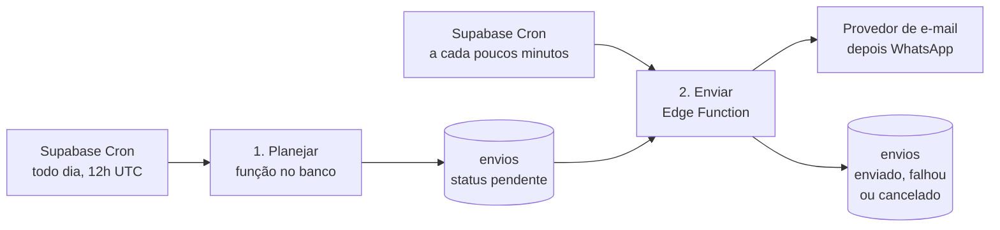

# ADR-0005: Rotina diária com Supabase Cron, em duas etapas

- **Status:** Aceita
- **Data:** 09/11/2026
- **Requisitos:** RF-02, RF-15, RF-34, RF-35, RN-09, RN-13, RN-19, RN-22, RNF-09, Q-09, Q-10

## Contexto

- A régua precisa disparar sozinha, todo dia às 9h de Brasília (RF-34, Q-10), sem ação do contador.
- A rotina não pode mandar a mesma mensagem duas vezes (RN-13), precisa se recuperar de dias em que não rodou (RN-22) e precisa avisar quando falhar (RNF-09).
- O passo de um lembrete pode cair em outro mês (SRS, seção 4.3), e a cobrança do mês precisa existir antes do primeiro lembrete (RF-02).
- Provedores de e-mail e WhatsApp podem ficar lentos ou fora do ar. Isso não pode travar o cálculo dos lembretes nem fazer perder mensagens.
- A stack é Next.js + Supabase (ADR-0001), e a chave que ignora a RLS só pode ser usada na rotina e nos avisos dos provedores (ADR-0004).

## Decisão

A rotina roda **dentro do Supabase**, agendada pelo **Supabase Cron**, e é dividida em duas etapas que se comunicam pela tabela `envios`.

### Etapa 1: planejar (função no banco)

- Agendada para **12h UTC**, que é **9h em Brasília**. O Brasil não tem horário de verão desde 2019; se ele voltar, só o horário do agendamento muda, porque a função calcula "hoje" no fuso `America/Sao_Paulo`.
- Uma função em SQL (PL/pgSQL) que recebe a data como parâmetro (`p_hoje`), para que os testes possam simular qualquer dia:
  1. cria as cobranças que ainda não existem: a do mês corrente e, quando o passo "3 dias antes" já cai neste mês, a do mês seguinte (RF-02, RN-21);
  2. calcula os passos de hoje com a regra do alvo (SRS, seção 4.3) e, se a última execução foi há mais de um dia, também os dos dias perdidos. De cada cliente, mantém só o passo mais recente; os anteriores entram como `pulado` (RN-22);
  3. grava cada lembrete como um envio `pendente`, com `insert ... on conflict do nothing`. O banco tem uma chave única por **cliente, mês, passo e canal** (só nos canais automáticos), então rodar duas vezes não duplica nada (RN-13);
  4. registra a execução na tabela `rotina_execucoes` (data, início, fim, situação e contagens).
- A função fica num esquema que **não é exposto pela API** do Supabase (por exemplo, `interno`), sem permissão de execução para `anon` e `authenticated`. Ela roda sem RLS, por isso filtra sempre por `contador_id` e é coberta por testes.
- **(proposto)** A mesma regra do alvo vira uma função usada também pela tela, para mostrar o "próximo lembrete" (RF-15). Assim a tela e a rotina nunca calculam de jeitos diferentes.

### Etapa 2: enviar (Edge Function)

- Uma Edge Function do Supabase, chamada pelo Supabase Cron **a cada poucos minutos**, que termina na hora se não houver nada pendente. O cron chama a função com um segredo guardado no Vault do Supabase.
- A cada chamada:
  1. separa um lote de envios `pendente` e marca como `enviando`, com `for update skip locked`, para que duas execuções ao mesmo tempo não peguem o mesmo envio;
  2. **confere de novo se a cobrança continua em aberto**. Se foi paga depois do planejamento, marca o envio como `cancelado` e não envia (RN-09);
  3. monta a mensagem com os dados atuais (texto do passo + pendências, RN-19) e chama o provedor. **(proposto)** Usa o id do envio como chave de idempotência do provedor, quando ele oferecer esse recurso;
  4. marca `enviado`, ou `falhou`.
- **(proposto) Novas tentativas:** erro temporário (provedor fora do ar, limite de envio) volta para `pendente` com nova tentativa marcada para mais tarde: até 3 tentativas, depois de 5 minutos, 30 minutos e 2 horas. Erro definitivo (endereço inválido, número inexistente) fica como `falhou` na hora e aparece para o contador (RF-35).
- **(proposto) Janela de envio:** só envia entre 9h e 20h de Brasília. O que sobrar depois das 20h espera o dia seguinte.
- Envio que ficou em `enviando` por mais de 10 minutos (por exemplo, se a função caiu no meio) volta para a fila.
- As chaves dos provedores ficam nos segredos das Edge Functions, nunca no código nem no banco.

### Alertas

- **(proposto)** Um terceiro agendamento, às 9h30 de Brasília, confere a `rotina_execucoes`. Se o planejamento do dia não terminou, ou se há envios pendentes há mais de 2 horas dentro da janela, a plataforma recebe um alerta por e-mail (RNF-09).
- Os registros técnicos (logs) não trazem o texto das mensagens nem dados pessoais, só ids e contagens (ADR-0003).

## Alternativas consideradas

| Alternativa | Por que não |
|---|---|
| Agendamento da Vercel chamando uma rota do Next.js | Deixa a rotina fora do banco e dependente da hospedagem e do plano contratado. A garantia de não duplicar continuaria tendo de ficar no banco |
| Uma única Edge Function que calcula e envia tudo | Um provedor lento travaria o cálculo; uma queda no meio deixaria o dia pela metade; reenviar uma falha obrigaria a recalcular tudo |
| Agendador externo (por exemplo, GitHub Actions) | Horário pouco preciso, mais um serviço com acesso privilegiado ao banco |
| Supabase Queues (pgmq) como fila | Funcionaria, mas duplicaria o estado: a tabela `envios` já é ao mesmo tempo a fila e o registro do que foi enviado. Pode ser revisto se o volume crescer muito |

## Consequências

**Positivas**
- O banco garante que não há envio duplicado, mesmo com execuções repetidas ou simultâneas.
- A tabela `envios` é a fila e também o histórico que o contador vê (RF-35).
- Falhas de provedor viram novas tentativas, sem recalcular a régua.
- A regra mais delicada (passos que caem em outro mês, recuperação de dias perdidos) fica numa função com a data como parâmetro, fácil de testar com pgTAP.

**Negativas e cuidados**
- A lógica fica em dois lugares e em duas linguagens: SQL no planejamento e TypeScript na Edge Function. A fronteira entre eles é a tabela `envios`.
- A função de planejamento roda sem RLS. Ela precisa de testes com dois contadores, como as tabelas (ADR-0004).
- As Edge Functions têm limite de tempo por execução; por isso o envio é feito em lotes pequenos.
- O mesmo desenho servirá para o WhatsApp na F4: muda só o provedor chamado na etapa 2.
